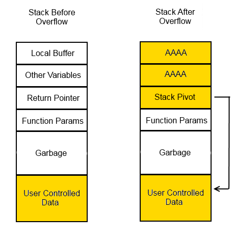
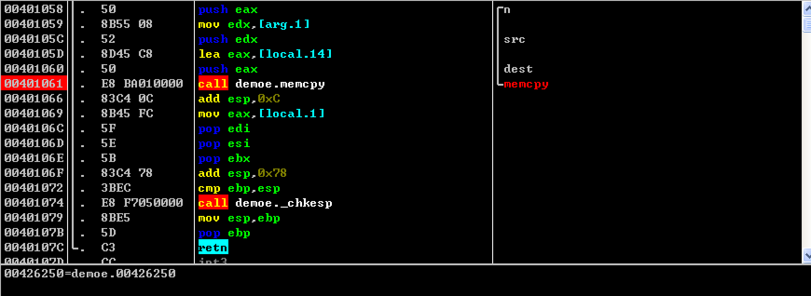
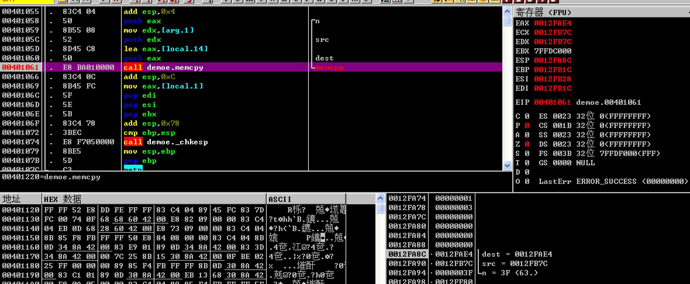
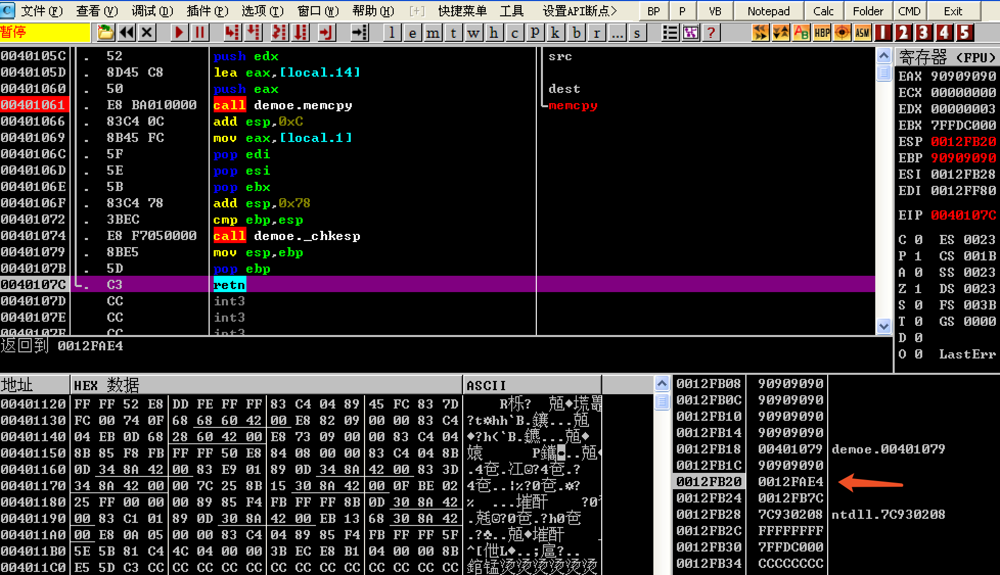
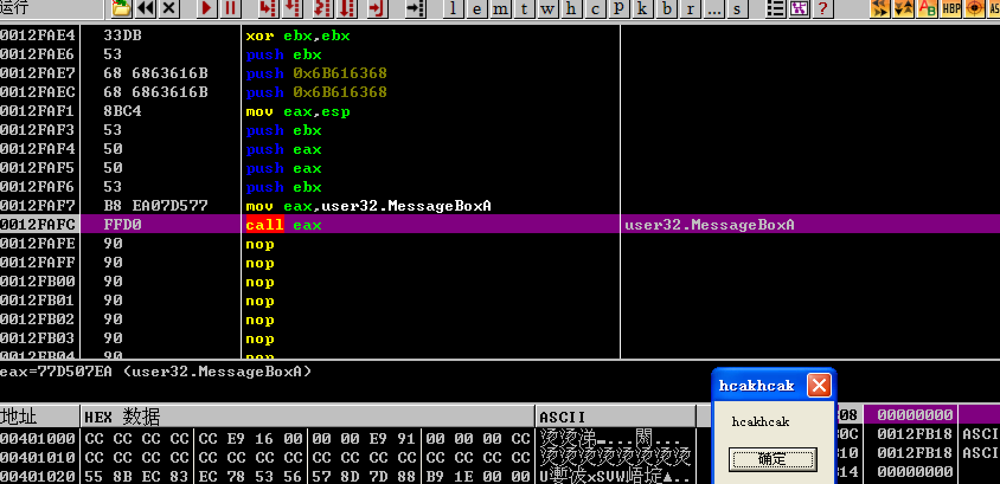

# Shellcode の実行

## はじめに

shellcode とは、ソフトウェアの脆弱性を突いて実行されるコードのことです。shellcode は16進数のマシンコードで、攻撃者にしばしば shell を取らせることから、この名が付きました。shellcode は多くの場合、機械語で書かれます。レジスタ eip をオーバーフローさせたあとに、CPU が実行できる shellcode のマシンコードを詰め込むと、コンピュータに攻撃者の任意の命令を実行させられます。コンパイル時に ASLR、NX、CANARY のオプションを無効にしておけば、入力時に shellcode をスタック上に配置できます。動的デバッグで必要な padding の長さを求め、戻りアドレスまでオーバーフローさせて、戻りアドレスを入力した shellcode のアドレスにします。すると、プログラムが戻ったあとに shellcode が実行されます。




### 例

以下に古典的な例を示します。プログラムがオーバーフローしたあとに **shellcode** が実行されることを確かめます。コンパイル環境は winxp、ツールは vc6.0 です。

```c
#include <stdio.h>
#include <windows.h>

#define PASSWORD "1234567"

int verify_password(char *password)
{
	int authenticated;
	char buffer[50];
	authenticated = strcmp(password,PASSWORD);
	memcpy(buffer,password,strlen(password)); 
	return authenticated;
}

void main()
{
	int valid_flag =0;
	char password[1024];
	FILE *fp;

	LoadLibrary("user32.dll");

	if (!(fp=fopen("password.txt","rw+")))
	{
		exit(0);
	}
	fscanf(fp,"%s",password);

	valid_flag = verify_password(password);

	if (valid_flag !=0)
	{
		printf("incorrect password!\n\n");
	}
	else
	{
		printf("Congratulation! You have passed the verification!\n");
	}
	fclose(fp);
	getchar();
}
```


コンパイルが終わったら OllyDbg に読み込んで動的デバッグし、**padding** の長さを確かめます。あとのデバッグを楽にするため、**memcpy** にブレークポイントを置きます。まず 50 BYTES の padding を作って戻りアドレスまでの距離と比べると、最終的に 60 BYTES のあとが戻りアドレスだとわかります。




入力した文字列は、スタック上の **0012FAE4** の位置にコピーされます。




適切な padding によって戻りアドレスを **0012FAE4** にできているので、関数が戻るときにレジスタ **EIP** の値は **0012FAE4** になります。このときシステムはスタック上のデータをマシンコードとみなし、プログラムはアドレス **0012FAE4** のコードを実行します。




**password.txt** の内容は、入念に組み立てたマシンコードで、**hackhack** と書かれたメッセージボックスを表示します。**password.txt** の内容をどう書くかは後の章で説明します。この章では、実行の流れ全体を中心に紹介します。

期待したとおり、プログラムが戻ったあとにポップアップ表示の機能が実行されました。




### 参考資料

[0day安全：软件漏洞分析技术]()

[cve-2015-8277](https://www.securifera.com/advisories/cve-2015-8277/)

