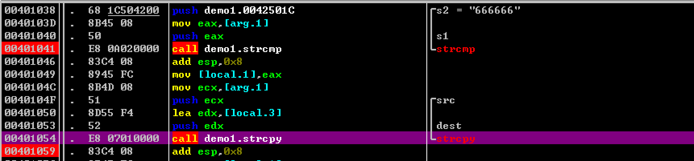
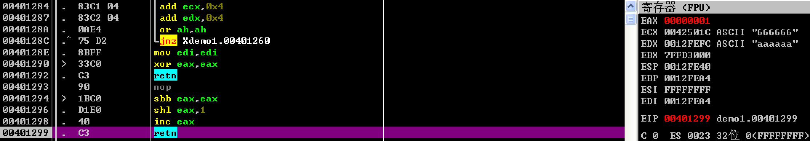
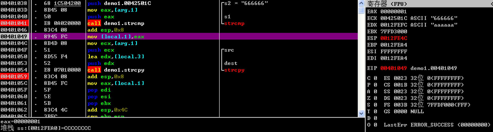
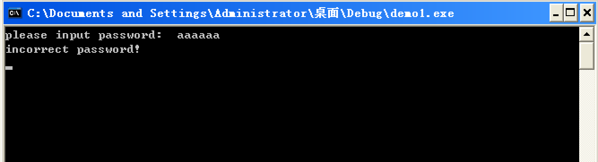
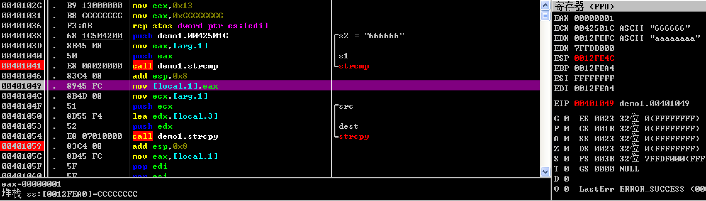
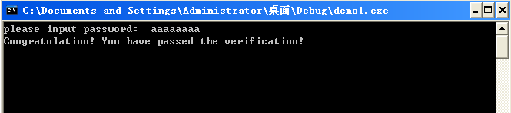

# スタックオーバーフローの原理

## はじめに

スタックについては、[Linux Pwn](https://ctf-wiki.org/pwn/linux/user-mode/stackoverflow/x86/stack-intro/) の説明を読んでください。

## 基本的な例

以下に典型的な例を示します。この例では、変数を宣言する順序と buffer の宣言サイズのせいで、最後の1バイトのオーバーフローが生じます。

```c
#include <stdio.h>
#include <string.h>
#define PASSWORD "666666"
int verify_password(char *password)
{
	int authenticated;
	char buffer[8];
	authenticated = strcmp(password,PASSWORD);
	strcpy(buffer,password); 
	return authenticated;
}
void main()
{
	int valid_flag =0;
	char password[128];
	while(1)
	{
		printf("please input password:  ");
		scanf("%s",password);
		valid_flag = verify_password(password);
		if (valid_flag !=0)
		{
			printf("incorrect password!\n");
		}
		else
		{
			printf("Congratulation! You have passed the verification!\n");
			break;
		}
	}
}
```

これは簡単なパスワード検証プログラムで、入力した文字列が 666666 と等しいかどうかを判定します。vc6.0 でこのプログラムをコンパイルし、成功したら winchecksec で有効になっている保護機構を確認します。GS は有効になっていますが、オーバーフローの妨げにはなりません。

```
C:\Users\CarlStar\Desktop>winchecksec.exe demo1.exe
Dynamic Base    : false
ASLR            : true
High Entropy VA : false
Force Integrity : false
Isolation       : true
NX              : true
SEH             : true
CFG             : false
RFG             : false
SafeSEH         : true
GS              : true
Authenticode    : false
.NET            : true
```

OllyDbg でこのプログラムを動的デバッグし、aaaaaa を入力してプログラムの通常の実行の流れを見ます。全体の流れを理解しやすくするため、**strcmp** 関数と **strcpy** の実行が終わった直後にブレークポイントを置きます。



ここでプログラムを実行させ、aaaaaa を入力すると、プログラムは最初に置いたブレークポイントまで実行されます。**strcmp** 関数に入り、その戻り値を観察します。a の ascii コード値は 6 の ascii コード値より大きいため、特に問題がなければ関数は **1** を返します。x86 では戻り値は EAX レジスタに保存されます。関数が正常に戻ったあと、プログラムは残りの機能を実行するのにこれらのレジスタをまた使うので、この戻り値はスタック上、つまり **ss:[0012FEA0]** の場所に保存されます。





2つ目のブレークポイントまで実行されたら、スタックの構造を見てみます。61 は入力した a の ascii コードの形で、**00** は文字列の終端文字です。**buffer** のサイズは 8 バイトなので、a を8個入力すると、最後の文字列終端文字が **0012FEA0** の位置にあふれて元の値を 0 で上書きします。こうすればプログラムの実行の流れを変えて、Congratulation! You have passed the verification! を出力させられます。

```
0012FE90   CCCCCCCC
0012FE94   CCCCCCCC
0012FE98   61616161
0012FE9C   CC006161
0012FEA0   00000001
```

では、まずプログラムを通常どおり最後まで実行させます。



今度は a を8個入力して、考えたとおりになるかを確かめます。**文字列の終端文字が strcmp の戻り値にあふれる**というものです。strcmp の戻り値はまだ 1 であることがわかります。



2つ目のブレークポイントまで実行を続けて、現在のスタックの値を確認します。**strcmp の戻り値が 1 から 0 へ、オーバーフローによって書き換わりました**。

```
0012FE90   CCCCCCCC
0012FE94   CCCCCCCC
0012FE98   61616161
0012FE9C   61616161
0012FEA0   00000000
```

ここでプログラムの実行を続けると、予想どおりの文字列の出力に成功しました。




## 参考資料

[stack buffer overflow](https://en.wikipedia.org/wiki/Stack_buffer_overflow)

[0day安全：软件漏洞分析技术]()

[Winchecksec](https://github.com/trailofbits/winchecksec)

