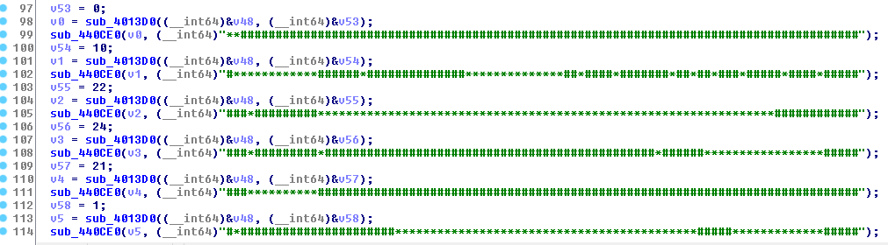
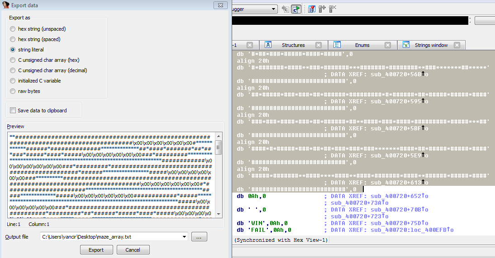
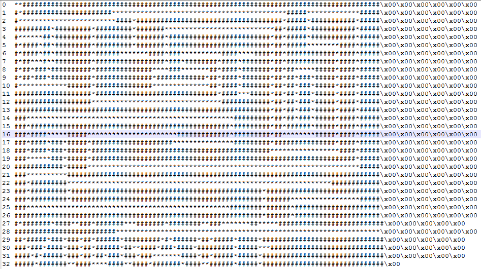
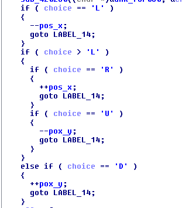
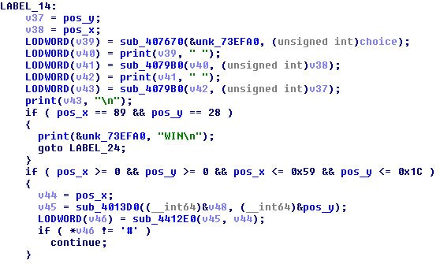
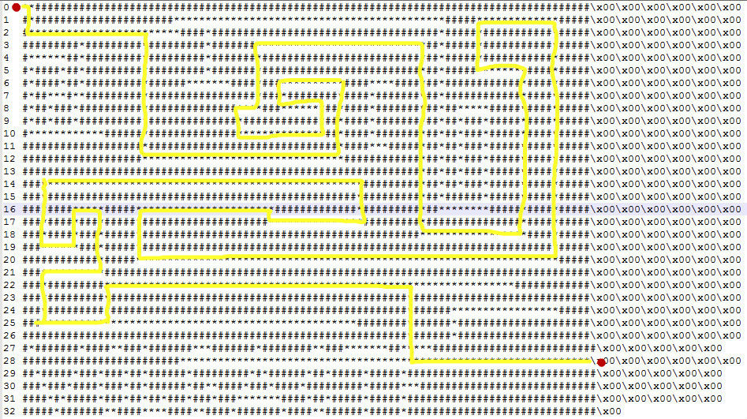

# 迷路問題

迷路問題には次のような特徴があります。

* メモリ上に「マップ」を配置する
* ユーザー入力を少数の文字の範囲に制限する
* 一般に、迷路の入口と出口は1つずつしかない

配置されるマップは、表示可能な文字(たとえば `#` と `*`)の組み合わせでできている場合があり(これは非常にわかりやすく、文字列を見ればほぼ迷路の問題だとわかります)、表示できない16進数の値だけで表されている場合もあります。マップを非常に長い1本の文字列にしてしまうこともあれば、1行ずつ分けて配置することもあります。1行ずつ分けて配置する場合、迷路は一般に大きいため、行単位で迷路を配置する関数が明らかに何度も繰り返されます(なお、配置は順番どおりではなく、各行には具体的な行番号が対応しており、迷路のマップを復元するにはその行番号を確かめる必要があります)。

制限される文字は、たいてい覚えやすい組み合わせです(そうでない場合は仕方ありません)。たとえば `w/s/a/d`、`h/j/k/l`、`l/r/u/d` のような組み合わせです。もちろん、各キーの具体的な動作は解析して判断する必要があります(迷路を1本の文字列だけで表しているものなら、`t` キーで右に `12` 文字進む、といった具合です)。2次元のマップでは、作者は通常、現在位置を保存するための `X座標` と `Y座標` を用意します。この特徴を手がかりに解析を始めることもできます。

通常、迷路の入口と出口は1つずつで、たとえば入口が左上端の `(0, 0)` の位置、出口が右下端の `(max_X, max_Y)` にあります。しかし、出口が迷路のちょうど中心にあり、`Y` という文字で表されている、といったこともあります。迷路の問題を解く条件も、具体的な状況に応じて判断する必要があります。

もちろん、迷路の進み方は1通りとは限らず、複数の進み方があって、そのうち特定のもの、たとえばコストが最小のものを求められる場合もあります。その場合は、アルゴリズムの問題に置き換えられます。

## Volga Quals CTF 2014: Reverse 100

ここでは、この問題を例に説明します。これは簡単な迷路の問題です。この問題ではマップが行単位でばらばらの順序に配置されており、使われている文字は `#` と `*` です。

対応する `crackme` はこちらからダウンロードできます: [rev100](https://github.com/ctf-wiki/ctf-challenges/blob/master/reverse/maze/2014_volga_quals/rev100)

対応する `idb` はこちらからダウンロードできます: [rev100.i64](https://github.com/ctf-wiki/ctf-challenges/blob/master/reverse/maze/2014_volga_quals/rev100.i64)



`.rodata` セグメントでカーソルを使ってマップの文字列をすべて選択し、`shift+E` を押すと、マップのデータをすべて取り出せます。



しかし、この時点で取り出したマップの文字列は、上から下へ順番に並んでいません。そのため、IDA が生成した疑似 C コードに戻って行番号を取得し、並べ替えて組み合わせる必要があります。

最終的に得られた完全なマップは次のとおりです。

対応する `迷路のマップファイル` はこちらからダウンロードできます: [maze_array.txt](https://github.com/ctf-wiki/ctf-challenges/blob/master/reverse/maze/2014_volga_quals/maze_array.txt)



次に、迷路の移動に必要な文字を見てみます。



ここから、使える文字は `L/R/U/D` で、それぞれ `左/右/上/下` に対応するとわかります。

さらに下を見てみます。



デバッグすると、ここでは、ユーザーが `L/R/U/D` を入力するたびに、まず入力内容を一度出力し、続いて対応する `X/Y座標` を出力していることがわかります。そして、最終的に成功と判定される条件は `pos_x == 89 && pos_y == 28` のときです。以上の情報から、迷路を抜ける経路を得られます。



最終的に得られた迷路の経路は次のとおりです。

```
RDDRRRRRRRRRRRRRRRRRRDDDDDDDDDDRRRRRRRRRRRRRRRRRRRRRRRRRRRRRRRUUUUUULLLLLLLLLDDRRRRRRDDLLLLLLLLLLLLLUURRRUUUUURRRRRRRRRRRRRRRRRRRRRRRRRRDDDDDDDDDDDDDDDRRRRRRRRRRRRRRRRUUUUUUUUUUUUULLLLLLLUUUURRRRRRRRRRRRDDDDDDDDDDDDDDDDDDDLLLLLLLLLLLLLLLLLLLLLLLLLLLLLLLLLLLLLLLLLLLLLLLLLLLLLLLLLLLLLLLLLLUUUURRRRRRRRRRRRRRRRRRRRRDRRRRRRRRRRRRRRUUULLLLLLLLLLLLLLLLLLLLLLLLLLLLLLLLLLLLLLLLLLLLLLLLLLDDDDDRRRRRUUURRRRDDDDDLLLLLLLLLDDDDRRRRRRRRRRUUURRRRRRRRRRRRRRRRRRRRRRRRRRRRRRRRRRRRRRRRRRRRRRRRDDDDDDRRRRRRRRRRRRRRRRRRRRRRRRRRRR
```

## 参考リンク

* [[VolgaCTF Quals 2014 writeup - Reverse-100](https://singularityctf.blogspot.com/2014/03/volgactf-quals-2014-writeup-reverse-100.html)]