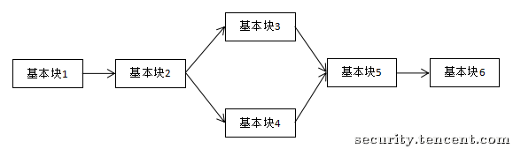
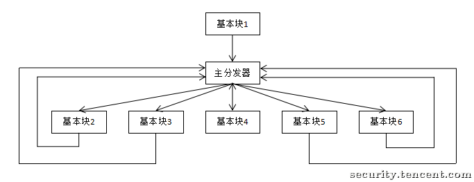

# 制御フローフラット化

## はじめに

制御フローフラット化(control flow flattening)は、制御フローグラフに作用するコード難読化技術です。基本的な考え方は、関数の制御フローグラフにおける基本ブロック間の関係を組み直し、「メインディスパッチャ」を挿入して基本ブロックの実行の流れを制御することです。たとえば、次の図は通常の実行の流れです。

制御フローフラット化を施すと次のような形になり、1つの「メインディスパッチャ」がプログラムの実行の流れを制御します。

制御フローフラット化によって基本ブロック間の前後関係が隠されるため、プログラムのリバース解析は難しくなります。制御フローフラット化の実装の詳細については、[この論文](http://ac.inf.elte.hu/Vol_030_2009/003.pdf)を参照してください。

## シンボリック実行による制御フローフラット化の除去

> 作成中。

## Reference

[Tencent Security Response Center - シンボリック実行による制御フローフラット化の除去](https://security.tencent.com/index.php/blog/msg/112)

[OBFUSCATING C++ PROGRAMS VIA CONTROL FLOW FLATTENING](http://ac.inf.elte.hu/Vol_030_2009/003.pdf)