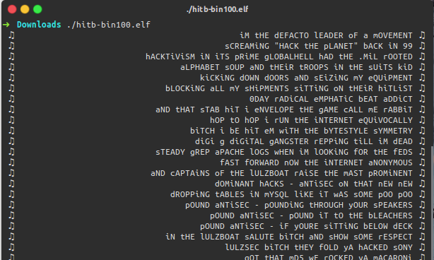
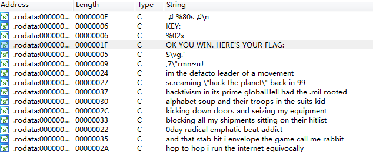
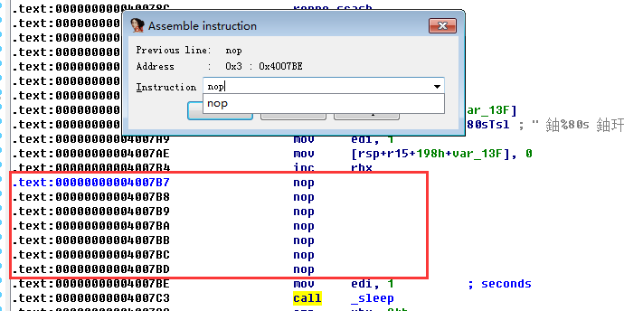
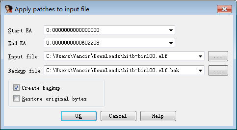
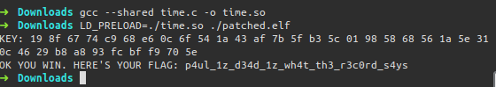

# LD_PRELOAD

## 原理

通常、Linux の動的ローダ `ld-linux`(man マニュアルの ld-linux(8) を参照)は、プログラムに必要な共有ライブラリのファイルを探して読み込みます。`LD_PRELOAD` は省略可能な環境変数で、共有ライブラリのファイルを指すパスを1つ以上含みます。ローダは、C 言語のランタイムライブラリより先に `LD_PRELOAD` で指定された共有ライブラリを読み込みます。これがいわゆるプリロード(`preload`)です。

プリロードされると、そのライブラリの関数が、ほかのライブラリファイルにある同名の関数より先に呼び出されます。これにより、ライブラリ関数を横取りしたり置き換えたりできます。複数の共有ライブラリファイルのパスは `コロン` または `空白` で区切れます。`LD_PRELOAD` の影響を受けないのは、当然ながら静的リンクされたプログラムだけです。

もちろん、悪意のある攻撃に使われるのを避けるため、`ruid != euid` の場合、ローダは `LD_PRELOAD` によるプリロードを行いません。

さらに読む: [https://blog.fpmurphy.com/2012/09/all-about-ld_preload.html#ixzz569cbyze4](https://blog.fpmurphy.com/2012/09/all-about-ld_preload.html#ixzz569cbyze4)

## 例題

以下では、2014年の `Hack In The Box Amsterdam: Bin 100` を例にします。問題のダウンロードリンク: [hitb_bin100.elf](https://github.com/ctf-wiki/ctf-challenges/blob/master/reverse/linux-re/2014_hitb/hitb_bin100.elf)

これは64ビットの ELF ファイルです。実行結果は次の図のとおりです。



プログラムは何かの文をずっと出力し続けているようで、止まる気配がありません。IDA で開いて見てみましょう。まず `Shift+F12` を押して文字列を探します。



出力され続けている文のほかに、いくつか興味深い文字列が見つかりました。

```
.rodata:0000000000400A53 00000006 C KEY:
.rodata:0000000000400A5F 0000001F C OK YOU WIN. HERE'S YOUR FLAG:
```

`OK YOU WIN. HERE'S YOUR FLAG: ` のクロスリファレンスをたどって重要なコードにたどり着きます(不要なコードは削除してあります)。

```  c
int __cdecl main(int argc, const char **argv, const char **envp)
{
  qmemcpy(v23, &unk_400A7E, sizeof(v23));
  v3 = v22;
  for ( i = 9LL; i; --i )
  {
    *(_DWORD *)v3 = 0;
    v3 += 4;
  }
  v20 = 0x31337;
  v21 = time(0LL);
  do
  {
    v11 = 0LL;
    do
    {
      v5 = 0LL;
      v6 = time(0LL);
      srand(233811181 - v21 + v6); // 乱数シードを初期化
      v7 = v22[v11];
      v22[v11] = rand() ^ v7;   // 疑似乱数
      v8 = (&funny)[8 * v11];
      while ( v5 < strlen(v8) )
      {
        v9 = v8[v5];
        if ( (_BYTE)v9 == 105 )
        {
          v24[(signed int)v5] = 105;
        }
        else
        {
          if ( (_DWORD)v5 && v8[v5 - 1] != 32 )
            v10 = __ctype_toupper_loc();    // 大文字
          else
            v10 = __ctype_tolower_loc();    // 小文字
          v24[(signed int)v5] = (*v10)[v9];
        }
        ++v5;
      }
      v24[(signed int)v5] = 0;
      ++v11;
      __printf_chk(1LL, " 鈾%80s 鈾玕n", v24); // 文字化けしているのは実は音符
      sleep(1u);
    }
    while ( v11 != 36 );
    --v20;
  }
  while ( v20 );
  v13 = v22;    // key は v22 配列に格納されている
  __printf_chk(1LL, "KEY: ", v12);
  do
  {
    v14 = (unsigned __int8)*v13++;
    __printf_chk(1LL, "%02x ", v14); // key を出力
  }
  while ( v13 != v23 );
  v15 = 0LL;
  putchar(10);
  __printf_chk(1LL, "OK YOU WIN. HERE'S YOUR FLAG: ", v16);
  do
  {
    v17 = v23[v15] ^ v22[v15];  // key の値と XOR する
    ++v15;
    putchar(v17);   // flag を出力
  }
  while ( v15 != 36 );
  putchar(10);      // 改行を出力
  result = 0;
  return result;
}
```

コードの流れ全体は、主に `funny` の中の文をひたすらループして出力し、ループの条件を満たしたら `key` を出力して、`key` と XOR して `flag` の値を得る、というものです。

ただし、ループの回数全体は比較的少ないことがわかります。そこで、ループをもっと速く進める方法を使えます。たとえば手動で patch して、プログラムに文字列を出力させないようにします(実際には `printf` の所要時間はかなり大きいです)。次に、`LD_PRELOAD` を使ってプログラムの `sleep()` を無効にします。これで時間を大幅に節約できます。

手動の patch は簡単です。コードの位置を見つけて、16進エディタなどで書き換えます。もちろん、`IDA` を使って patch することもできます。

``` asm
.text:00000000004007B7                 call    ___printf_chk
.text:00000000004007BC                 xor     eax, eax
```

カーソルを `call    ___printf_chk` に合わせ、メニューの `Edit->Patch Program->Assemble` を選びます(もちろん、ほかの patch の方法でも構いません。効果は同じです)。そして `nop(0x90)` に書き換えます。次の図のとおりです。



`4007B7` から `4007BD` までのアセンブリコードをすべて `nop` に書き換えれば完了です。そのあと、メニューの `Edit->Patch Program->Apply patches to input file` を選びます。もちろん、バックアップを取っておくのが望ましく(`Create a backup` にチェックを入れます)、OK をクリックすれば完了です(私は `patched.elf` という名前に変更しました。ダウンロードリンク: [patched.elf](https://github.com/ctf-wiki/ctf-challenges/blob/master/reverse/linux-re/2014_hitb/patched.elf)).



ここから `LD_PRELOAD` の部分に入ります。簡単な C コードを書きます。ダウンロードリンク: [time.c](https://github.com/ctf-wiki/ctf-challenges/blob/master/reverse/linux-re/2014_hitb/time.c)

``` c
static int t = 0x31337;

void sleep(int sec) {
	t += sec;
}

int time() {
	return t;
}
```

次に、`gcc --shared time.c -o time.so` というコマンドで動的リンクファイルを生成します。こちらもダウンロードリンクを示します: [time.so](https://github.com/ctf-wiki/ctf-challenges/blob/master/reverse/linux-re/2014_hitb/time.so)

そのあと Linux のターミナルを開き、`LD_PRELOAD=./time.so ./patched.elf` というコマンドを実行します。



しばらくすると CPU が猛烈に回る音が聞こえ、すぐに flag が出てきます。
