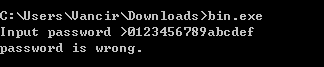
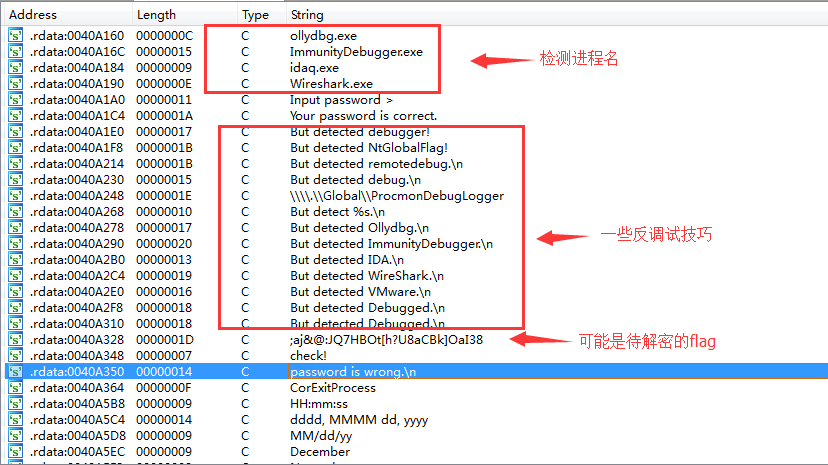
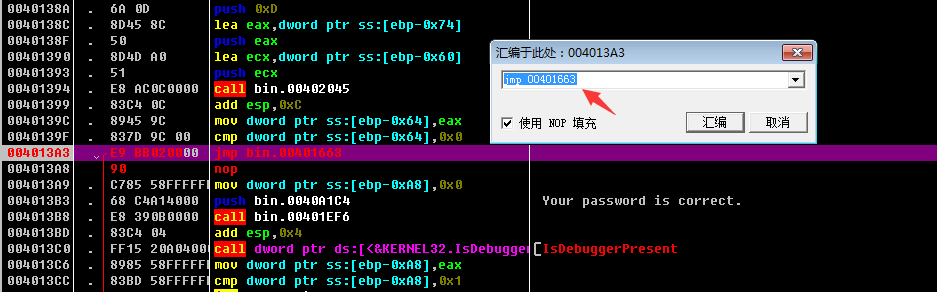
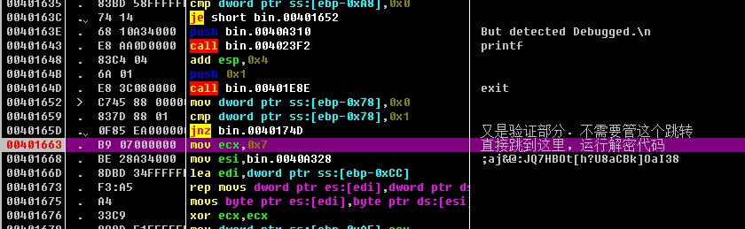
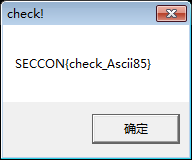

# アンチデバッグ技術の例題

ここでは、2016年の SecCon の `anti-debugging` の問題を解析します。問題のダウンロードリンク: [bin.exe](https://github.com/ctf-wiki/ctf-challenges/blob/master/reverse/anti-debug/2016_seccon/anti_debugging_100/bin.exe)

これは32ビットの PE ファイルでコンソールプログラムです。そのまま実行すると `password` の入力を求められます。誤った `password` を入力すると、`password is wrong` と表示されます。



IDA で開いて見てみましょう。最も手早い方法は、文字列を直接見て、`password is wrong` から重要なコードを探すことです。IDA の表示結果は次の図のとおりです。



文字列から、プログラムにはさまざまな検出が入っていそうだとわかります。たとえば、プロセス名 `ollydbg.exe`、`ImmunityDebugger.exe`、`idaq.exe`、`Wireshark.exe` の検出です。そのほかの検出もあります。`password is wrong` と `You password is correct` という文字列も見えます。同時に、復号すべき flag の文字列らしきものも見つかりました。そこで、まず `password is wrong` のクロスリファレンスから重要な関数にたどり着きましょう。

次のとおり、プログラムはやはり大量のアンチデバッグのテクニックを使っています。

``` c
int __cdecl main(int argc, const char **argv, const char **envp)
{
  v23 = 0;
  memset(&v24, 0, 0x3Fu);
  v22 = 1;
  printf("Input password >");
  v3 = (FILE *)sub_40223D();
  fgets(&v23, 64, v3);
  strcpy(v21, "I have a pen.");
  v22 = strncmp(&v23, v21, 0xDu); // 1. 平文の文字列と入力文字列を直接比較
  if ( !v22 )
  {
    puts("Your password is correct.");
    if ( IsDebuggerPresent() == 1 )     // 2. API: IsDebuggerPresent()
    {
      puts("But detected debugger!");
      exit(1);
    }
    if ( sub_401120() == 0x70 )         // 3. PEB のオフセット 0x68 が 0x70 かどうかを検出。NtGlobalFlag() の検出
    {
      puts("But detected NtGlobalFlag!");
      exit(1);
    }

    /*  BOOL WINAPI CheckRemoteDebuggerPresent(
     *    _In_    HANDLE hProcess,
     *    _Inout_ PBOOL  pbDebuggerPresent
     *  );
     */
    v4 = GetCurrentProcess();
    CheckRemoteDebuggerPresent(v4, &pbDebuggerPresent);
    if ( pbDebuggerPresent )            // 4. API: CheckRemoteDebuggerPresent()
    {
      printf("But detected remotedebug.\n");
      exit(1);
    }
    v13 = GetTickCount();
    for ( i = 0; i == 100; ++i )
      Sleep(1u);
    v16 = 1000;
    if ( GetTickCount() - v13 > 1000 )  // 5. 時間差の検出
    {
      printf("But detected debug.\n");
      exit(1);
    }
    lpFileName = "\\\\.\\Global\\ProcmonDebugLogger";
    if ( CreateFileA("\\\\.\\Global\\ProcmonDebugLogger", 0x80000000, 7u, 0, 3u, 0x80u, 0) != (HANDLE)-1 )
    {
      printf("But detect %s.\n", &lpFileName);      // 6. ProcessMonitor の検出
      exit(1);
    }
    v11 = sub_401130();     // 7. API: CreateToolhelp32Snapshot() でプロセスを検出
    if ( v11 == 1 )
    {
      printf("But detected Ollydbg.\n");
      exit(1);
    }
    if ( v11 == 2 )
    {
      printf("But detected ImmunityDebugger.\n");
      exit(1);
    }
    if ( v11 == 3 )
    {
      printf("But detected IDA.\n");
      exit(1);
    }
    if ( v11 == 4 )
    {
      printf("But detected WireShark.\n");
      exit(1);
    }
    if ( sub_401240() == 1 )    // 8. vmware の I/O ポートによる検出
    {
      printf("But detected VMware.\n");
      exit(1);
    }
    v17 = 1;
    v20 = 1;
    v12 = 0;
    v19 = 1 / 0;
    ms_exc.registration.TryLevel = -2;  // 9. SEH
    printf("But detected Debugged.\n");
    exit(1);
  }
  printf("password is wrong.\n");
  return 0;
}
```

コードの中にコメントを書き、使われている9つの保護技術の部分を列挙しました。1つずつ解析していきましょう。

## 平文の文字列の比較

``` c
printf("Input password >");
v3 = (FILE *)sub_40223D();
fgets(&v23, 64, v3);
strcpy(v21, "I have a pen.");
v22 = strncmp(&v23, v21, 0xDu); // 1. 平文の文字列と入力文字列を直接比較
if ( !v22 )  {
    ......
}
```

ここでは `Input password >` を出力します。次に `fgets()` でユーザーが入力した文字列を取得し、`I have a pen.` を `v21` のバッファにコピーして、`strncmp` でユーザー入力と `I have a pen.` の内容を比較し、比較結果を `v22` に返します。以下では `v22`、つまり入力した `password` が正しいかどうかに応じてジャンプします。

## IsDebuggerPresent()

``` c
puts("Your password is correct.");
if ( IsDebuggerPresent() == 1 )     // 2. API: IsDebuggerPresent()
{
    puts("But detected debugger!");
    exit(1);
}
```

当然、入力した `password` が正しければ、`Your password is correct.` と表示されます。???おかしいと思いませんか。まさか `I have a pen.` が flag なのでしょうか。いやいや、もちろん違います。これは実は罠で、`I have a pen.` を知っているということは、何らかのリバースエンジニアリングの手段でプログラムを解析しているに違いありません。そこで、これ以降の部分では、アンチデバッグなどの検出手段が始まります(実際にもこのような罠は出てきます)。

最初は `IsDebuggerPresent()` で、戻り値によってデバッグされているかどうかを判断します。よくわからない場合は、戻って [IsDebuggerPresent()](./isdebuggerpresent.md) の章を見てください。

## NtGlobalFlag

次は `NtGlobalFlag` フィールドのフラグビットの検出です。PEB のフィールドの値が `0x70` かどうかでデバッガを検出します。よくわからない場合は、戻って [NtGlobalFlag](./ntglobalflag.md) の章を見てください。

``` c
if ( sub_401120() == 0x70 )         // 3. PEB のオフセット 0x68 が 0x70 かどうかを検出。NtGlobalFlag() の検出
{
    puts("But detected NtGlobalFlag!");
    exit(1);
}
```

では、`sub_401120()` を簡単に見てみましょう。

``` c
int sub_401120()
{
  return *(_DWORD *)(__readfsdword(48) + 0x68) & 0x70;
}
```

`0x68` は PEB の `NtGlobalFlag` フィールドに対応するオフセット値です。`0x70` は `FLG_HEAP_ENABLE_TAIL_CHECK (0x10)`、`FLG_HEAP_ENABLE_FREE_CHECK (0x20)`、`FLG_HEAP_VALIDATE_PARAMETERS (0x40)` の3つのフラグを合わせたものです。

## CheckRemoteDebuggerPresent


``` c++
/*  BOOL WINAPI CheckRemoteDebuggerPresent(
 *    _In_    HANDLE hProcess,
 *    _Inout_ PBOOL  pbDebuggerPresent
 *  );
 */
v4 = GetCurrentProcess();
CheckRemoteDebuggerPresent(v4, &pbDebuggerPresent);
if ( pbDebuggerPresent )            // 4. API: CheckRemoteDebuggerPresent()
{
    printf("But detected remotedebug.\n");
    exit(1);
}
```
ついでに、コメントの中に `CheckRemoteDebuggerPresent()` という API の関数プロトタイプも載せておきました。デバッガの存在を検出すると、`pbDebuggerPresent` が 0 以外の値に設定されます。その値に基づいてデバッガを検出します([CheckRemoteDebuggerPresent()](./checkremotedebuggerpresent.md) の章を参照)。


## 時間差の検出

``` c
v13 = GetTickCount();
for ( i = 0; i == 100; ++i )    // スリープ
    Sleep(1u);
v16 = 1000;
if ( GetTickCount() - v13 > 1000 )  // 5. 時間差の検出
{
    printf("But detected debug.\n");
    exit(1);
}
```

`GetTickCount` は、起動から現在までのミリ秒数を返します。ループの中だけで `sleep(1)` が100回行われるので、100ミリ秒になります。2回取得した時間の差が1000ミリ秒より大きければ、時間差が実際にかかった時間よりも明らかに大きいので、間接的にデバッグが検出されたことになります。


## ProcessMonitor

``` c
lpFileName = "\\\\.\\Global\\ProcmonDebugLogger";
if ( CreateFileA("\\\\.\\Global\\ProcmonDebugLogger", 0x80000000, 7u, 0, 3u, 0x80u, 0) != (HANDLE)-1 )
{
    printf("But detect %s.\n", &lpFileName);      // 6. ProcessMonitor の検出
    exit(1);
}
```

ここでは、デバイスファイル `\\\\.\\Global\\ProcmonDebugLogger` を調べることで `ProcessMonitor` を検出します。

## プロセス名の検出

ここでは `sub_401130()` 関数を実行してプロセスを検出し、検出したプロセスの違いに応じて対応する値を返します。

``` c
v11 = sub_401130();     // 7. API: CreateToolhelp32Snapshot() でプロセスを検出
if ( v11 == 1 )
{
    printf("But detected Ollydbg.\n");
    exit(1);
}
if ( v11 == 2 )
{
    printf("But detected ImmunityDebugger.\n");
    exit(1);
}
if ( v11 == 3 )
{
    printf("But detected IDA.\n");
    exit(1);
}
if ( v11 == 4 )
{
    printf("But detected WireShark.\n");
    exit(1);
}
```

`sub_401130()` 関数を見てみましょう。

``` c
signed int sub_401130()
{
  PROCESSENTRY32 pe; // [sp+0h] [bp-138h]@1
  HANDLE hSnapshot; // [sp+130h] [bp-8h]@1
  int i; // [sp+134h] [bp-4h]@1

  pe.dwSize = 296;
  memset(&pe.cntUsage, 0, 0x124u);
  hSnapshot = CreateToolhelp32Snapshot(2u, 0);
  for ( i = Process32First(hSnapshot, &pe); i == 1; i = Process32Next(hSnapshot, &pe) )
  {
    if ( !_stricmp(pe.szExeFile, "ollydbg.exe") )
      return 1;
    if ( !_stricmp(pe.szExeFile, "ImmunityDebugger.exe") )
      return 2;
    if ( !_stricmp(pe.szExeFile, "idaq.exe") )
      return 3;
    if ( !_stricmp(pe.szExeFile, "Wireshark.exe") )
      return 4;
  }
  return 0;
}
```

ここでは API の `CreateToolhelp32Snapshot` を使って現在のプロセス情報を取得し、for ループの中で順に比較しています。指定されたプロセス名が見つかれば、そのまま対応する値を返します。そして、戻り値に応じて別々の分岐へジャンプします。

## VMware の検出

VMware の検出も、いくつかの特徴を調べるものです。検出の結果に基づいて判断します。

``` c
if ( sub_401240() == 1 )    // 8. vmware の I/O ポートによる検出
{
    printf("But detected VMware.\n");
    exit(1);
}
```

`sub_401240()` 関数を見てみましょう。

``` c
signed int sub_401240()
{
  unsigned __int32 v0; // eax@1

  v0 = __indword(0x5658u);
  return 1;
}
```

これは VMware の「バックドア」I/O ポートで、`0x5658 = "VX"` です。プログラムが VMware の中で動作しているとき、`In` 命令でポート `0x5658` からデータを読み取ると、`EBX` レジスタの値が `0x564D5868`(`0x564D5868 == "VMXh"`)になります。

IDA がデコンパイルした疑似 C コードでは、この点はあまり直感的にはわかりません。アセンブリコードを見ればはっきりします。

``` asm
.text:0040127A                 push    edx
.text:0040127B                 push    ecx
.text:0040127C                 push    ebx
.text:0040127D                 mov     eax, 564D5868h   //  <------
.text:00401282                 mov     ebx, 0
.text:00401287                 mov     ecx, 0Ah
.text:0040128C                 mov     edx, 5658h   //  <------
.text:00401291                 in      eax, dx
.text:00401292                 pop     ebx
.text:00401293                 pop     ecx
.text:00401294                 pop     edx
```

さらに読む: [E-cards don?t like virtual environments](https://isc.sans.edu/diary/E-cards+don%3Ft+like+virtual+environments/3190)

## SEH

``` c
v17 = 1;
v20 = 1;
v12 = 0;
v19 = 1 / 0;    // 9. SEH
ms_exc.registration.TryLevel = -2;
printf("But detected Debugged.\n");
exit(1);
```

このあとの部分は、おかしいと思いませんか。ここの `v19 = 1 / 0;` は明らかに道理に合わず、ゼロ除算の例外を引き起こします。その後ろの `ms_exc.registration.TryLevel = -2;` は例外の解除で、`TryLevel=TRYLEVEL_NONE (-2)` です。アセンブリコードを見てみましょう。

```
.text:004015B8                 mov     [ebp+var_88], 1
.text:004015C2                 mov     [ebp+var_7C], 1
.text:004015C9                 mov     [ebp+var_9C], 0
.text:004015D3                 mov     [ebp+ms_exc.registration.TryLevel], 0
.text:004015DA                 mov     eax, [ebp+var_7C]
.text:004015DD                 cdq
.text:004015DE                 idiv    [ebp+var_9C]
.text:004015E4                 mov     [ebp+var_80], eax
.text:004015E7                 mov     [ebp+ms_exc.registration.TryLevel], 0FFFFFFFEh
.text:004015EE                 jmp     short loc_40160A
```

ここの `idiv [ebp+var_9C]` が例外を引き起こすと、プログラムが登録した例外ハンドラが引き継ぎます。例外ハンドラの入口にブレークポイントを設定していないと、プログラムは暴走しやすくなります。

## flag の取得

しかし、全体を見終えても、flag とはまったく関係がないように感じませんか。先ほど文字列ウィンドウで見た、復号すべき flag らしき文字列を覚えていますか。実は IDA のデコンパイルの限界のため、デコンパイルされた疑似 C コードは正しくありません。たとえば、最後の部分の `printf("But detected Debugged.\n");` のところについて、具体的なアセンブリコードを見てみましょう。

``` asm
.text:00401627                 call    sub_4012E0
.text:0040162C                 movzx   eax, ax
.text:0040162F                 mov     [ebp+var_A8], eax
.text:00401635                 cmp     [ebp+var_A8], 0      // <------
.text:0040163C                 jz      short loc_401652     // <------
.text:0040163E                 push    offset aButDetectedD_2 ; "But detected Debugged.\n"
.text:00401643                 call    _printf
.text:00401648                 add     esp, 4
.text:0040164B                 push    1               ; int
.text:0040164D                 call    _exit
```

実際には、この部分のコードは IDA にデコンパイルされていません。そして `loc_401652` の位置にはコードの並びがあり、見どころは `MessageBoxA` という関数を使っていることです。しかも関数の引数の1つが、復号すべき flag です。そこで、`I have a pen.` を入力したあと、`if ( !v22 )` のジャンプのアセンブリコードの部分を手動で書き換え、flag の復号と `messagebox` の表示を行う部分にジャンプして実行させれば、プログラム自身に復号と出力をしてもらえます。

操作は次の図のとおりです。



ここは `I have a pen.` を入力したあとのジャンプの部分です。通常ジャンプする先は、すべてデバッグの検出の内容なので、直接コードの復号の部分に飛びます。つまり `00401663` の位置です。



`00401663` より上の `mov-cmp-jnz` も検証の部分ですが、気にせず、`00401663` の `mov ecx, 7` に直接ジャンプして復号コードを実行します。そして、そのまま `MessageBoxA()` を実行してメッセージボックスを表示させ、flag を手に入れます。


