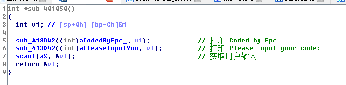
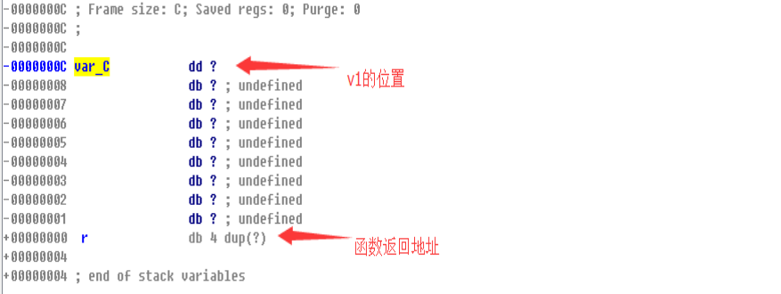
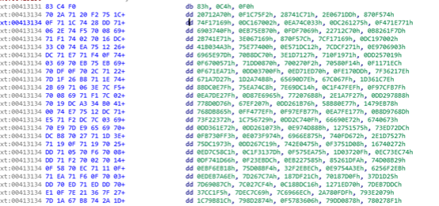
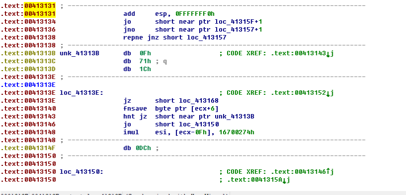
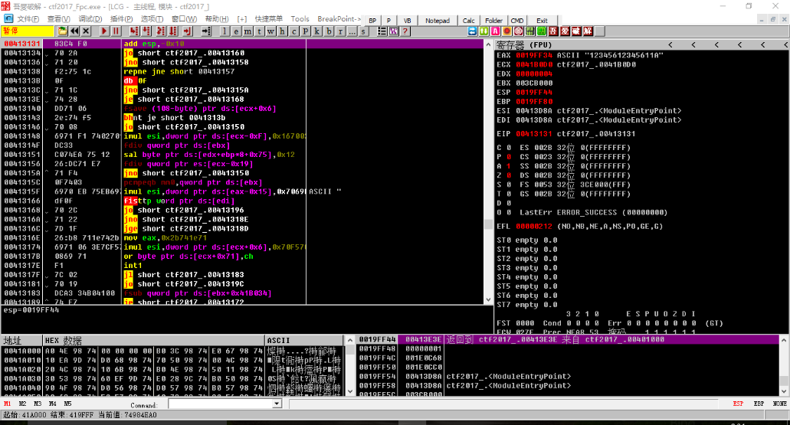
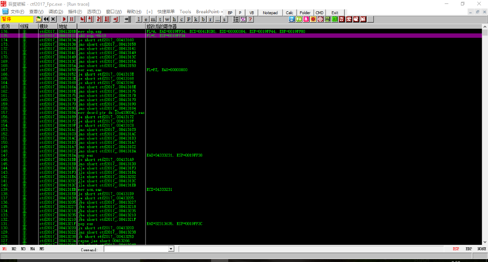
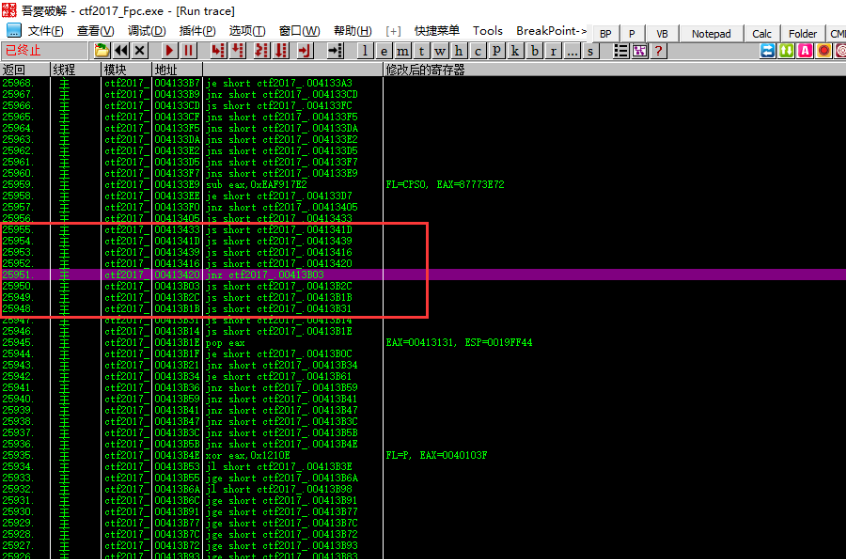
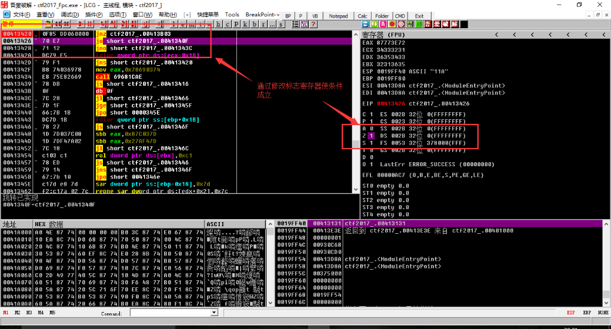

# ジャンクコード(花指令)

## 原理

ジャンクコード(花指令)は、リバースエンジニアリングされたくないコードブロック(やその他の機能)を隠そうとする方法の1つです。本物のコードの中にゴミのコードを挿入しながら、元のプログラムが正しく実行されることを保証します。その一方でプログラムはうまくデコンパイルできず、内容を理解するのが難しくなって、目くらましの効果が得られます。

ジャンクコードは、通常、静的解析の難易度を上げるために使われます。

## 書き方

最も簡単なジャンクコードはインラインアセンブリを使って作ります。以下では VC でジャンクコードを追加する方法を例にします。gnu のコンパイラでも同様の方法でジャンクコードを追加できますが、AT&T 構文のアセンブリを使います。

```c
// 通常の関数のコード
int add(int a, int b){
  int c = 0;
  c = a + b;
  return c;
}
// ジャンクコードを追加した関数のコード
int add_with_junk(int a, int b){
	int c = 0;
	__asm{
		jz label;
		jnz label;
		_emit 0xe8;    call 命令。後ろに4バイトのアドレスオフセットが付くため、逆アセンブラが正しく認識できなくなる
label:
	}
	c = a + b;
	return c;
}

```

ida でデコンパイルすると、ジャンクコードを追加した関数は正しく認識できず、結果は次のようになります。

疑似コード:

```asm
// ジャンクコードを追加した
.text:00401070 loc_401070:                             ; CODE XREF: sub_401005↑j
.text:00401070                 push    ebp
.text:00401071                 mov     ebp, esp
.text:00401073                 sub     esp, 44h
.text:00401076                 push    ebx
.text:00401077                 push    esi
.text:00401078                 push    edi
.text:00401079                 lea     edi, [ebp-44h]
.text:0040107C                 mov     ecx, 11h
.text:00401081                 mov     eax, 0CCCCCCCCh
.text:00401086                 rep stosd
.text:00401088                 mov     dword ptr [ebp-4], 0
.text:0040108F                 jz      short near ptr loc_401093+1
.text:00401091                 jnz     short near ptr loc_401093+1
.text:00401093
.text:00401093 loc_401093:                             ; CODE XREF: .text:0040108F↑j
.text:00401093                                         ; .text:00401091↑j
.text:00401093                 call    near ptr 3485623h
.text:00401098                 inc     ebp
.text:00401099                 or      al, 89h
.text:0040109B                 inc     ebp
.text:0040109C                 cld
.text:0040109D                 mov     eax, [ebp-4]
.text:004010A0                 pop     edi
.text:004010A1                 pop     esi
.text:004010A2                 pop     ebx
.text:004010A3                 add     esp, 44h
.text:004010A6                 cmp     ebp, esp
.text:004010A8                 call    __chkesp
.text:004010AD                 mov     esp, ebp
.text:004010AF                 pop     ebp
.text:004010B0                 retn
```

上の例では、目くらましのジャンクコードを nop に patch すれば修復でき、そのあとは普通に解析できます。

注意すべきなのは、ida はスタックの判定が比較的厳密なため、push や ret の類のジャンクコードが逆アセンブラの正常な動作を妨げることです。以下に具体的な例を示します。読者は自分でコンパイルして再現できます。

```c++
#include <stdio.h>
// gcc/g++ でコンパイルする
int main(){
	__asm__(".byte 0x55;");          // push rbp   スタックを保存 
	__asm__(".byte 0xe8,0,0,0,0;");  // call $5;	
	__asm__(".byte 0x5d;");	         // pop rbp -> rip の値を取得 
	__asm__(".byte 0x48,0x83,0xc5,0x08;"); // add rbp, 8
	__asm__(".byte 0x55;");          // push rbp -> call の戻り値を下の方へ書き換えるのと同じ
	__asm__("ret;");
	__asm__(".byte 0xe8;");          // これは目くらましの命令で実行されない
	__asm__(".byte 0x5d;");          // pop rbp スタックを復元		
	printf("whoami \n");
	return 0;
} 
```


## 例題

ここでは `看雪.TSRC 2017CTF秋季赛`(Kanxue.TSRC 2017 CTF 秋季大会)の第2問を使って説明します。問題のダウンロードリンク: [ctf2017_Fpc.exe](https://github.com/ctf-wiki/ctf-challenges/blob/master/reverse/anti-debug/2017_pediy/ctf2017_Fpc.exe)

プログラムには目くらましの関数がいくつか書かれており、重要な検証ロジックにはジャンクコードが加えられて、IDA による静的解析が防がれています。IDA で Fpc というこの問題を開くと、プログラムはまずいくつかのメッセージを出力し、そのあとユーザーの入力を受け取ります。



ここでは安全でない `scanf` 関数が使われており、ユーザー入力のバッファは `0xCh` の長さしかありません。`v1` をダブルクリックしてスタックフレームのビューに入ります。



したがって、データをオーバーフローさせて戻りアドレスを上書きし、任意のアドレスに移って実行を続けられます。

ここで説明しておく必要があるのは、`scanf` の前に書かれている目くらましの関数がいくつかの簡単な方程式で、実際には解がないということです。プログラムは本当の検証ロジックにジャンクコードを加えて難読化しているので、IDA ではうまくデコンパイルできません。そのため、この問題の方針は、オーバーフローによって本当の検証コードの場所に移って実行を続けることです。

解析していると、コードの近くに次のようなデータブロックが見つかります。



IDA はこのデータをうまく識別できていないので、カーソルをデータブロックの先頭に移し、`C` キー(code)を押して、このデータを逆アセンブルしてコードにします。



注意すべきなのは、このコードの位置が `0x00413131` で、`0x41` は `'A'` の ascii コード、`0x31` は `'1'` の ascii コードであることです。看雪(Kanxue)の大会の制限のため、ユーザー入力は英字と数字しか使えませんが、オーバーフローの脆弱性を使ってこのコードを実行することは十分にできます。

OD で開き、`Ctrl+G` で `0x413131` に移動してブレークポイントを設定します。実行して `12345612345611A` を入力し Enter を押すと、プログラムは `0x00413131` に無事到達します。そのあと `右クリック 分析->モジュールから分析を削除` で、正しいコードを識別させます。



`0x413131` で停止したら、メニューバーの `「表示」` から `「RUN トレース」` を選び、さらに `「デバッグ」` から `「トレースステップイン」` を選びます。プログラムはこのジャンクコードの実行の過程を記録します。次の図のとおりです。



このジャンクコードは本来とても長いのですが、OD のトレース機能を使うと、ジャンクコードの実行の流れが非常にはっきりします。全体の過程で大量のジャンプが行われているので、その中の有効な命令だけを取り出して解析すればよいのです。

注意すべきなのは、有効な命令の中でも、いくつかの条件ジャンプを満たす必要があることです。そうしないと、プログラムは正しいロジックのまま実行を続けられません。

たとえば `0x413420` にある `jnz ctf2017_.00413B03` です。最初からやり直して、`0x413420` にブレークポイントを設定します。



フラグレジスタを書き換えて、ジャンプの条件を満たします。そのままトレースステップインを続けます(このあとにも、満たす必要のある `0041362E  jnz ctf2017_.00413B03` があります)。ロジックが正しいことを確かめたら、有効な命令を取り出して解析を続ければよいのです。


