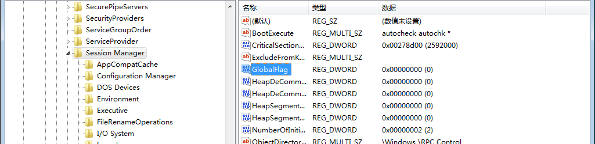
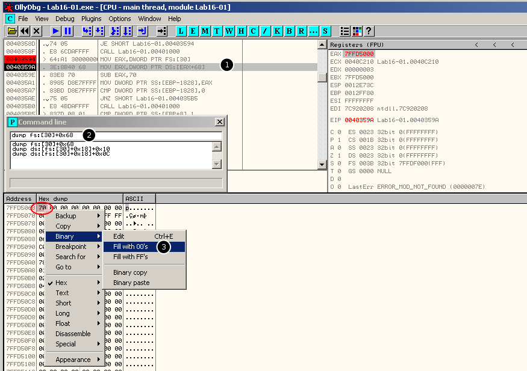

# NtGlobalFlag

## NtGlobalFlag について

32ビットのマシンでは、`NtGlobalFlag` フィールドは `PEB`(プロセス環境ブロック、Process Environment Block)のオフセット `0x68` にあり、64ビットのマシンではオフセット `0xBC` にあります。このフィールドの既定値は 0 です。デバッガが動作しているとき、このフィールドは特定の値に設定されます。この値はデバッガが本当に動いていることをあまり確実には示しませんが、このフィールドはその目的でよく使われます。

このフィールドには一連のフラグビットが含まれています。デバッガによって作成されたプロセスでは、次のフラグビットが設定されます。

```c
FLG_HEAP_ENABLE_TAIL_CHECK (0x10)
FLG_HEAP_ENABLE_FREE_CHECK (0x20)
FLG_HEAP_VALIDATE_PARAMETERS (0x40)
```

## 検出コード

そのため、これらのフラグビットを調べることで、デバッガが存在するかどうかを検出できます。たとえば、次のような32ビットコードで32ビットのマシン上で検出できます。

``` asm
mov eax, fs:[30h] ;Process Environment Block
mov al, [eax+68h] ;NtGlobalFlag
and al, 70h
cmp al, 70h
je being_debugged
```

次は、64ビットのマシン上で64ビットコードを使う検出コードです。

``` asm
push 60h
pop rsi
gs:lodsq                ;Process Environment Block
mov al, [rsi*2+rax-14h] ;NtGlobalFlag
and al, 70h
cmp al, 70h
je being_debugged
```

注意すべきなのは、32ビットのプログラムが64ビットのマシン上で動作する場合、実際には PEB が2つ存在することです。1つは32ビット側のもの、もう1つは64ビット側のものです。64ビットの PEB の対応するフィールドも、32ビットのものと同じように変化します。

そこで、次のような、32ビットコードで64ビットのマシン環境を検出する方法もあります。

```
mov eax, fs:[30h] ; Process Environment Block
;64-bit Process Environment Block
;follows 32-bit Process Environment Block
mov al, [eax+10bch] ;NtGlobalFlag
and al, 70h
cmp al, 70h
je being_debugged
```

ほかのビットをマスクせずに直接比較してはいけません。そうすると、デバッガを検出できなくなります。

`ExeCryptor` では `NtGlobalFlag` を使ってデバッガを検出しています。ただし、`NtGlobalFlag` のその3つのフラグビットは、プログラムが `デバッガによって作成された` プロセスであるときにだけ設定され、`デバッガがアタッチした` プロセスでは設定されません。

## NtGlobalFlag の初期値の変更

この検出を回避する方法ももちろん非常に簡単で、デバッガがなんらかの方法でこのフィールドを 0 に設定し直せばよいのです。ただし、この既定の初期値は、次の4つの方法のどれでも変更できます。

1. レジストリ `HKLM\System\CurrentControlSet\Control\SessionManager` の `GlobalFlag` の値が、`NtGlobalFlag` フィールドに置き換えられます。このあと Windows によってさらに変更される可能性もありますが(後述します)、このレジストリ値はシステム内のすべてのプロセスに影響し、再起動後に有効になります。

    

    これは、デバッガを検出するもう1つの方法も生みます。デバッガが自分を隠すために、レジストリの値を `NtGlobalFlag` フィールドにコピーしたとします。ところが、レジストリの値は事前に置き換えられていて、まだ再起動による有効化がされていません。その場合、デバッガは偽の値をコピーしただけで、本当に必要な値ではありません。プログラムが、レジストリにある偽の値ではなく、本当の値を知っていれば、デバッガの存在に気付けます。

    もちろん、デバッガは別のプロセスを実行して `NtGlobalFlag` フィールドを問い合わせ、本当の値を取得することもできます。

2. 同じく `GlobalFlag` ですが、こちらは `HKLM\Software\Microsoft\Windows NT\CurrentVersion\Image File Execution Options\<filename>` のものです(イメージファイル実行オプションによるハイジャック)。`<filename>` を、変更したい実行ファイルのファイル名に置き換える必要があります(パスの指定は不要です)。`GlobalFlag` を設定すると、システムはその値を `NtGlobalFlag` フィールドに上書きします(指定したプロセスに対してだけ個別に上書きします)。ただし、これも再び Windows によって変更される場合があります(後述)。
3. ロード構成テーブル(`Load Configuration Table`)の2つのフィールド `GlobalFlagsClear` と `GlobalFlagsSet` です。

    `GlobalFlagsClear` にはクリアしたいフラグビットが、`GlobalFlagsSet` には設定したいフラグビットが列挙されます。これらの設定は `GlobalFlag` が適用されたあとに有効になるため、`GlobalFlag` で指定された値を上書きできます。ただし、Windows が自分で設定するフラグビットは上書きできません。たとえば `FLG_USER_STACK_TRACE_DB (0x1000)` を設定すると、Windows が `FLG_HEAP_VALIDATE_PARAMETERS (0x40)` フラグビットを設定します。`FLG_HEAP_VALIDATE_PARAMETERS` がロード構成テーブル(`Load Configuration Table`)でクリアされていても、Windows はそのあとのプロセスのロード過程で改めて設定します。

4. デバッガがプロセスを作成するとき、Windows はいくつかの変更を行います。環境変数の `_NO_DEBUG_HEAP` を設定すると、`NtGlobalFlag` は、デバッガが原因で設定されるはずの3つのヒープのフラグビットを設定しなくなります。もちろん、それらは `GlobalFlag` やロード構成テーブルの `GlobalFlagsSet` を通じて、引き続き設定できます。


## 検出をどう回避するか

`NtGlobalFlag` の検出を回避する方法は、次の3つです。

* フラグビットの値を手動で書き換える(`FLG_HEAP_ENABLE_TAIL_CHECK`、`FLG_HEAP_ENABLE_FREE_CHECK`、`FLG_HEAP_VALIDATE_PARAMETERS`)
* Ollydbg で `hide-debug` プラグインを使う
* Windbg でデバッグヒープを無効にする方式でプログラムを起動する(`windbg -hd program.exe`)

## 手動での回避の例

以下は、検出を手動で回避する方法を示す例です。

``` asm
.text:00403594     64 A1 30 00 00 00          mov     eax, large fs:30h   ; PEB struct loaded into EAX
.text:0040359A                                db      3Eh                 ; IDA Pro display error (the byte is actually used in the next instruction)
.text:0040359A     3E 8B 40 68                mov     eax, [eax+68h]      ; NtGlobalFlag (offset 0x68 relative to PEB) saved to EAX
.text:0040359E     83 E8 70                   sub     eax, 70h            ; Value 0x70 corresponds to all flags on (FLG_HEAP_ENABLE_TAIL_CHECK, FLG_HEAP_ENABLE_FREE_CHECK, FLG_HEAP_VALIDATE_PARAMETERS)
.text:004035A1     89 85 D8 E7 FF FF          mov     [ebp+var_1828], eax
.text:004035A7     83 BD D8 E7 FF FF 00       cmp     [ebp+var_1828], 0   ; Check whether 3 debug flags were on (result of substraction should be 0 if debugged)
.text:004035AE     75 05                      jnz     short loc_4035B5    ; No debugger, program continues...
.text:004035B0     E8 4B DA FF FF             call    s_selfDelete        ; ...else, malware deleted
```

Ollydbg でオフセット `0x40359A` にブレークポイントを設定し、プログラムを実行してブレークポイントで止めます。次に `CommandLine` プラグインを開き、`dump fs:[30]+0x68` で `NtGlobalFlag ` の内容をダンプします。



右クリックして `Binary->Fill with 00's` を選び、値 `0x70` を `0x00` に置き換えれば完了です。

## 参考リンク

* [The "Ultimate" Anti-Debugging Reference](http://anti-reversing.com/Downloads/Anti-Reversing/The_Ultimate_Anti-Reversing_Reference.pdf)
* [PEB-Process-Environment-Block/NtGlobalFlag](https://www.aldeid.com/wiki/PEB-Process-Environment-Block/NtGlobalFlag)
