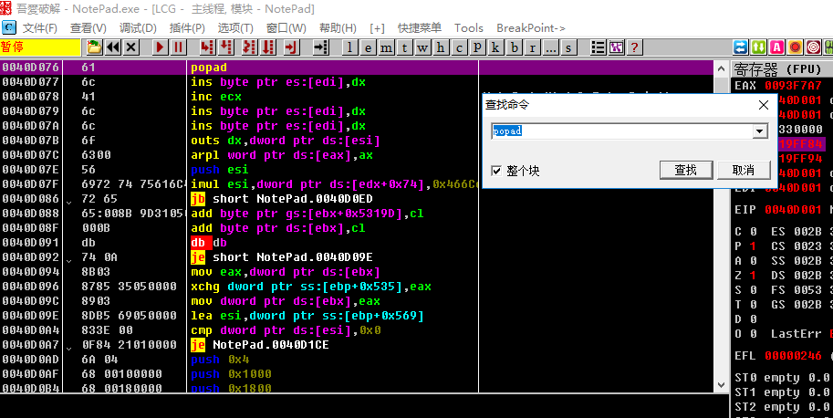
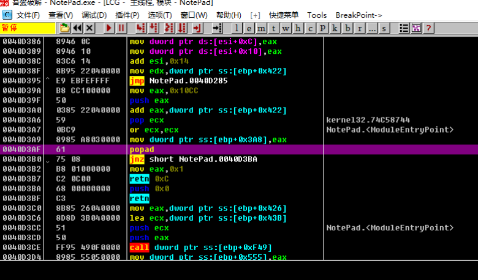

# 一気に OEP へ到達する方法

一気に OEP へ到達するアンパック方法とは、アンパックする対象の特徴に基づいて、OEP に最も近いアセンブリ命令を探し、そこに int3 ブレークポイントを置いて、プログラムが OEP に到達したときにプログラムをダンプする方法です。

たとえば、一部の圧縮パッカーでは popad 命令や大きな jmp が OEP のすぐ近くにあることが多いので、Ollydbg の検索機能でパッカーに特徴的なアセンブリコードを検索すれば、一気にブレークして OEP に到達できます。

## 要点

1. ctrl+f で popad を検索する
2. ctrl+l で次の一致箇所へジャンプする
3. 一致箇所を見つけたら、パッカーの展開が終わって OEP へジャンプする直前の部分であることを確認し、その位置にブレークポイントを設定して実行する
4. ごく一部の圧縮パッカーにしか使えない

## 例

サンプルプログラムはこちらからダウンロードできます: [3_direct2oep.zip](https://github.com/ctf-wiki/ctf-challenges/blob/master/reverse/unpack/3_direct2oep.zip)

引き続き元の notepad.exe を例にします。`Ollydbg` で開いたら、`ctrl+f` を押して指定した文字列を検索します。`popad` は典型的な特徴の1つで、状態の復元に `popad` をよく使うパッカーがあるため、下図のように `popad` を検索します。

この例では、検索で見つかった `popad` が求める条件に合わないときは、`ctrl+l` を押して次の一致箇所を検索できます。3、4回ほど押すと、OEP へジャンプする位置が見つかりました。

