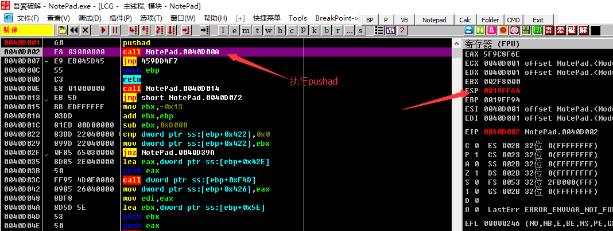
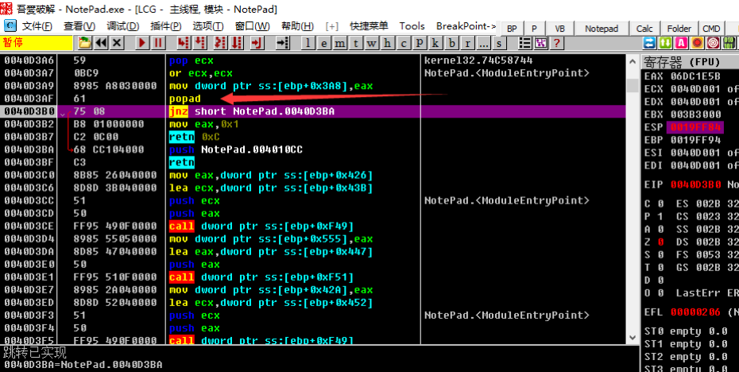

# ESP 法則

ESP 法則は、アンパックの強力な手段で、最もよく使われるアンパック方法の1つです。

## 要点

ESP 法則の原理は、プログラム内のスタックのバランスを利用して、すばやく OEP を見つけることです。

プログラムの自己復号や自己展開の過程では、多くのパッカーがまず現在のレジスタの状態をスタックに積みます(たとえば `pushad` を使います)。そして展開が終わったあとに、先ほどのレジスタの値をスタックから取り出します(たとえば `popad` を使います)。そのため、レジスタをスタックから取り出すときには、たいていプログラムのコードが復元されており、このときハードウェアブレークポイントが発動します。そこから、現在の位置で少しだけステップ実行すれば、正しい OEP の位置に簡単に到達できます。

1. プログラムのロード直後に pushad/pushfd がある
2. すべてのレジスタをスタックに積んだら、ESP レジスタにハードウェアブレークポイントを設定する
3. プログラムを実行し、ブレークポイントを発動させる
4. ハードウェアブレークポイントを削除して解析を始める

## 例

サンプルプログラムはこちらからダウンロードできます: [2_esp.zip](https://github.com/ctf-wiki/ctf-challenges/blob/master/reverse/unpack/2_esp.zip)

前の記事の例をそのまま使います。エントリの最初が `pushad` なので、F8 を押して `pushad` を実行し、レジスタの状態を保存します。右側のレジスタウィンドウで、`ESP` レジスタの値が赤色に変わっている、つまり値が変化したことがわかります。

`ESP` レジスタの値、つまり図の `0019FF64` を右クリックし、`HW break[ESP]` を選んでから `F9` を押してプログラムを実行すると、ブレークポイントが発動したところでプログラムが停止します。図のように `0040D3B0` の位置に来ました。ここは前の記事でステップトレースしたときに到達した位置で、残りは繰り返しません。

