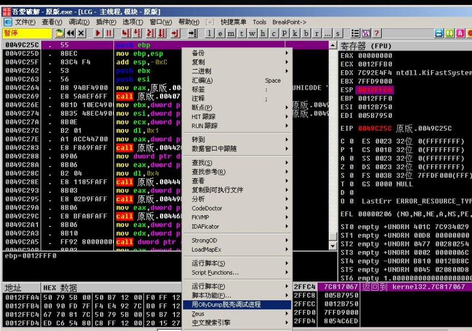
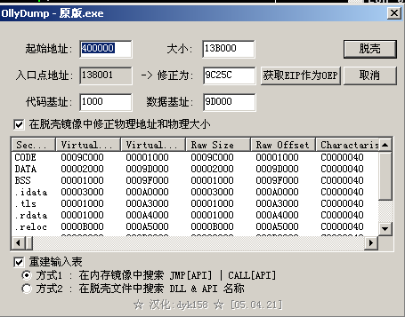
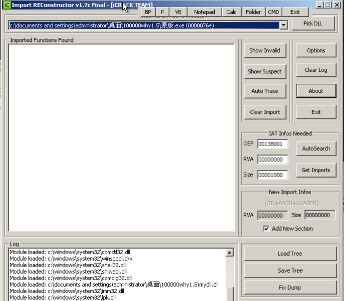
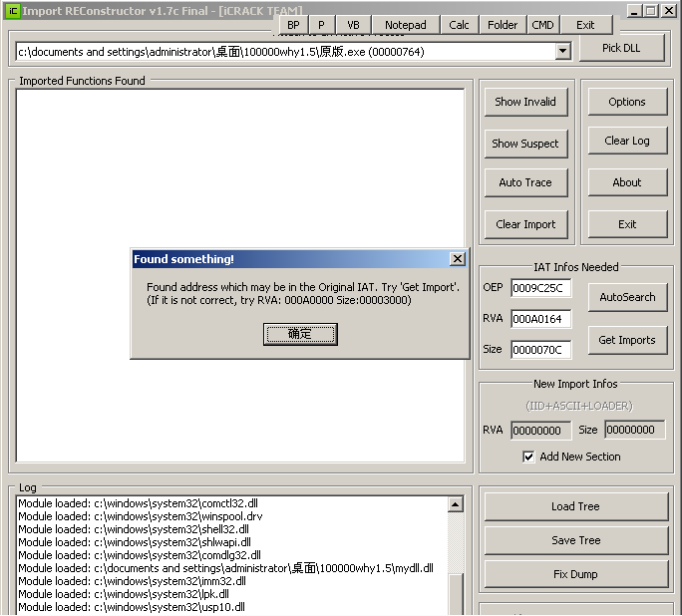
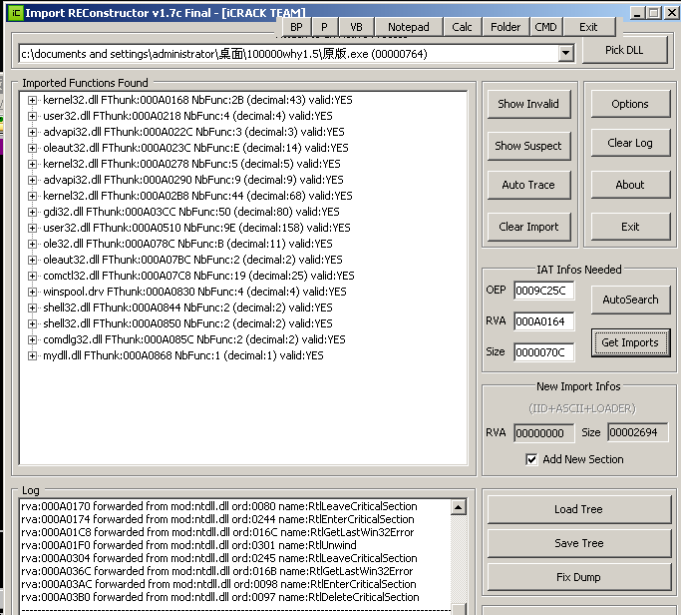

# DUMP と IAT の再構築

## 原理

プログラムの OEP を見つけたら、プログラムをダンプし、`IAT` を再構築する必要があります。`IAT` の正式名称は `Import Address Table` で、各エントリは関数の実際のアドレスを指します。

## 例

たとえば次のように、OEP を見つけ、プログラムの本当のエントリポイントに到達したとします。このとき、プログラムをダンプする必要があります。右クリックして `"OllyDump でデバッグ中のプロセスをアンパック"` を選びます(`LoadPE` でダンプしてもかまいません)。

ウィンドウが開くので、アドレスが正しいかどうか、主に `エントリポイントのアドレス` が正しく選ばれているかを確認します。そのあと、`インポートテーブルを再構築` のチェックを外します。

ダンプしたファイルに名前を付けます。ここでは `dump.exe` としました。`dump.exe` を実行してみると、プログラムが正常に動作しないことがわかります。単純なパッカーでも、ダンプしたものが正常に動作しないことがあります。正しい OEP を見つけ、`IDA` でデコンパイルした結果も良好なら、最初に疑うべきはプログラムの `IAT` に問題が生じていることです。`IAT` を再構築する必要があります。

インポートテーブルの修復には `ImportREC` を使います。

`ImportREC` を開き、実行中のプロセス `原版.exe` を選びます(`原版.exe` は OD でデバッグ中のプロセスで、OD の `EIP` は `OEP` の位置にあります。`Ollydump` を使ったあとも、このプロセスは閉じないでください)。`ImportREC` でインポートテーブルのエントリポイントを修復するには `OEP` を知る必要があり、ウィンドウ右側中央の `OEP` の入力欄に入力します。

Ollydbg から、プログラムの現在のエントリポイントが `0049C25C`、イメージベースが `00400000` であることがわかっています。

したがって、ここで `OEP` として入力すべきなのは `0009C25C` です。

`ImportREC` の `OEP` を `0009C25C` に書き換えて `AutoSearch` をクリックすると、「元の IAT のアドレスらしきものが見つかりました」というメッセージボックスが表示されます。

`"Get Imports"` ボタンをクリックすると `IAT` を再構築できます。左側には、`IAT` の各インポート関数のアドレスと、それが有効かどうかが表示されます。図を見ると、`ImportREC` がメモリ上の `IAT` の位置を見つけ、各関数が有効であると判定したことがわかります。

`Fix Dump` をクリックし、先ほど `OllyDump` プラグインでダンプしたファイル、つまり `dump.exe` ファイルを開きます。

すると `ImportREC` がインポートテーブルの復元を行い、`dump_.exe` ファイルを生成します。`dump_.exe` は正常に動作します。
