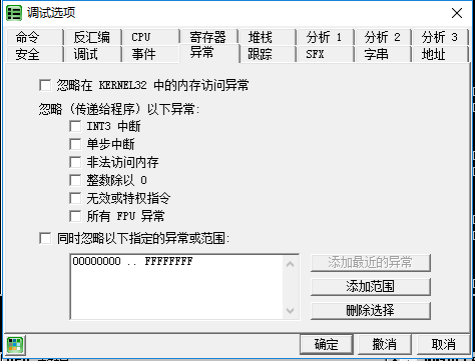
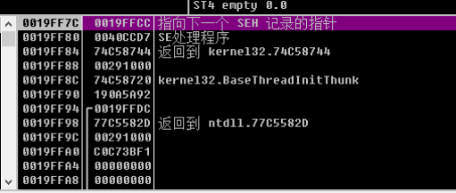
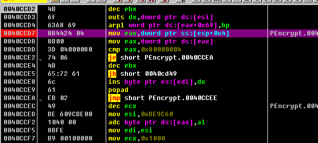
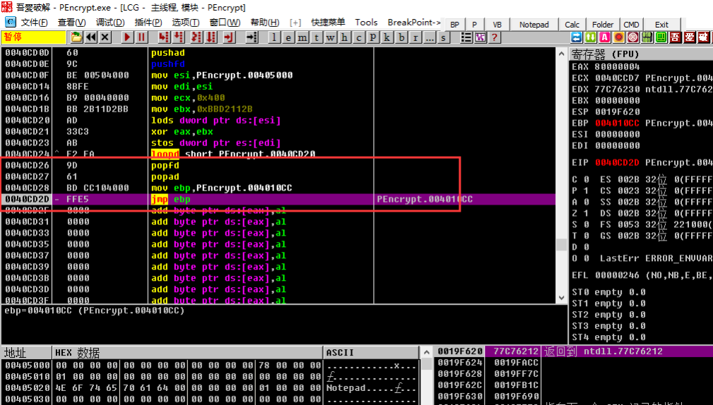
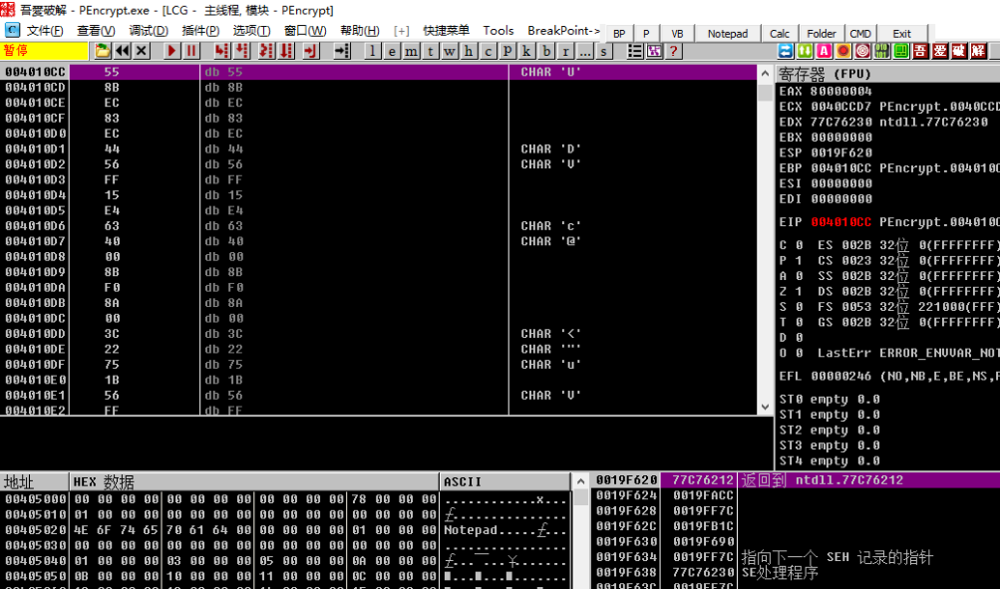

# 最後の例外の方法

最後の例外の方法の原理は、プログラムが自己展開や自己復号を行う過程で、数えきれないほどの例外が発生しうる、というものです。プログラムで最後に例外が発生した位置を特定できれば、自動アンパックが完了する位置にかなり近いと考えられます。現在、最後の例外によるアンパックでは、Ollydbg の例外カウンタプラグインを使い、まず例外の回数を記録してからプログラムを再ロードすると、最後の例外のところで自動的に停止します。

## 要点

1. `オプション->デバッグオプション->例外` をクリックし、中のチェックをすべて外します。`CTRL+F2` でプログラムを再ロードします
2. プログラムの最初はジャンプなので、ここで `SHIFT+F9` を押し、プログラムが動作するまで続けます。最初からプログラムが動作するまでに `SHIFT+F9` を押した回数 `m` を記録します
3. `CTRL+F2` でプログラムを再ロードし、`SHIFT+F9` を押します(今回押す回数は、プログラムが動作するまでの回数から1を引いた `m-1` 回です)
4. OD の右下に「`SE ハンドル`」があるのが見えるので、ここで `CTRL+G` を押し、`SE ハンドル` の前にあるアドレスを入力します
5. F2 でブレークポイントを設定します。そのあと `SHIFT+F9` でブレークポイントまで進み、F8 でステップトレースします

## 例

サンプルプログラムはこちらからダウンロードできます: [5_last_exception.zip](https://github.com/ctf-wiki/ctf-challenges/blob/master/reverse/unpack/5_last_exception.zip)

OD でプログラムを読み込み、メニューの `オプション->デバッグ設定->例外タブ` で、無視する例外のチェックをすべて外してから、プログラムを再ロードします。

`Shift+F9` を押して、何回押したかを記録します。プログラムは正常に動作します。知りたいのは、最後から2番目に押したのが何回目だったかです。この例では次のとおりです。

* `shift+F9` を1回押すと、`0040CCD2` の位置に来る
* `shift+F9` を2回押すと、プログラムが正常に動作する

そこで、プログラムを再ロードして `Shift+F9` を1回(`2-1=1`)だけ押し、`0040CCD2` の位置に来ます。スタックウィンドウを見ると、`SE ハンドラ: 0040CCD7` があります。

CPU ウィンドウ(アセンブリ命令)で `Ctrl+G` を押し、`0040CCD7` を入力して、そこで F2 を押します。つまり `0040CCD7` にブレークポイントを設定し、`Shift+F9` で実行して、ブレークポイントを発動させます。

ブレークポイントが発動したら、ステップトレースします。この先はループとジャンプばかりですが、F4 でループをスキップします。最終的に次の位置に到達します。

最後の `mov ebp, 0041010CC; jmp ebp` が OEP へのジャンプであることは明らかなので、そこへジャンプします。下図のとおりです。

明らかに、運良く OEP に到達できました。
