# IAT を手動で探して ImportREC で再構築する

サンプルプログラムはこのリンクからダウンロードできます: [manually_fix_iat.zip](https://github.com/ctf-wiki/ctf-challenges/blob/master/reverse/unpack/manually_fix_iat.zip)

普段 `ImportREC` でアンパックするときは、ソフトウェアに付属の `IAT auto search` を使いますが、`IAT` のアドレスを手動で探して `dump` したい場合は、どうすればよいでしょうか。

まず ESP 法則を使うと、`OEP: 00401110` にすばやくジャンプできます。

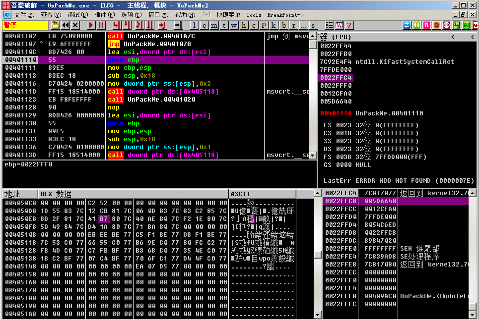

右クリックして `検索->すべてのモジュール間呼び出し` を選びます。

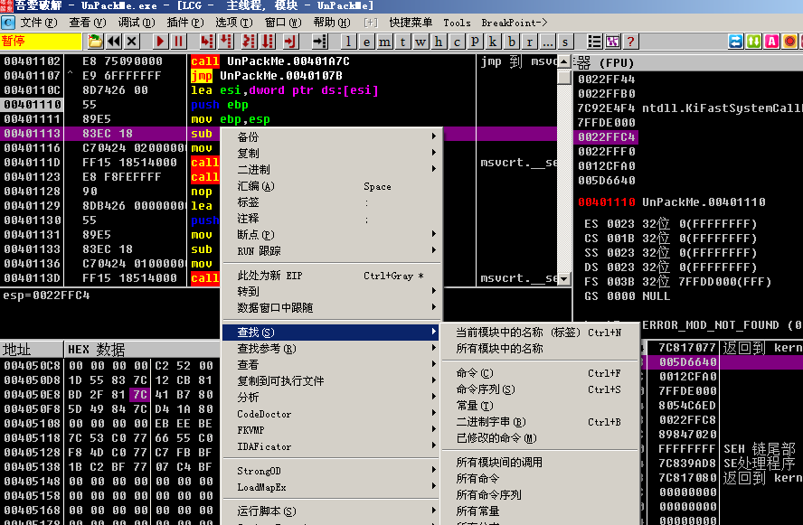

呼び出された関数の一覧が表示されるので、その中のどれかをダブルクリックします(ここでダブルクリックすべきなのは、システム関数ではなくプログラムの関数です)。

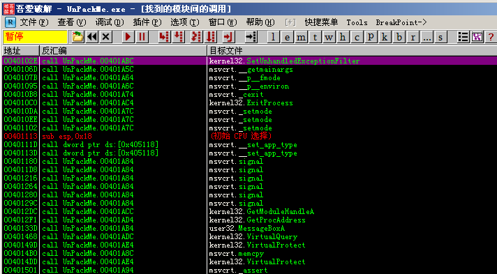

関数の呼び出し箇所に来ました。

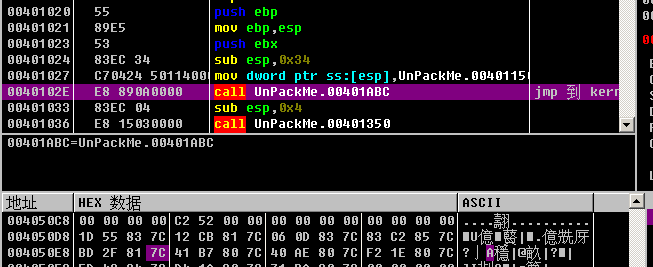

右クリックして `追跡` を選び、関数に入ります。

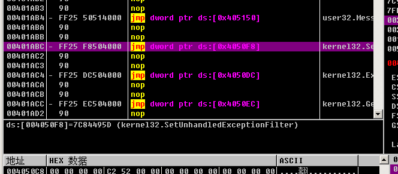

次に、右クリックして `データウィンドウで追跡->メモリアドレス` を選びます。

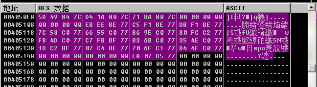

ここは16進数の値で表示されていて見づらいので、データウィンドウで右クリックして `ロング->アドレス` を選ぶと、関数名を表示できます。

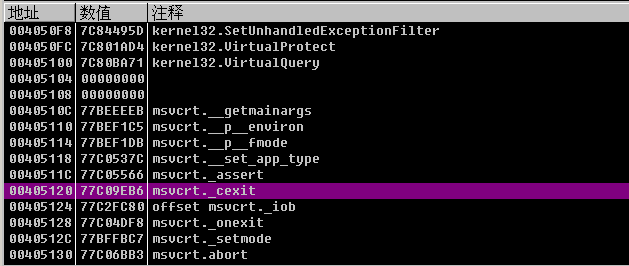

IAT テーブルの先頭の位置まで上にスクロールする必要があります。最初の関数のアドレスは `004050D8` の `kernel.AddAtomA` だとわかります。下へ進んで最後の関数、つまり `user32.MessageBoxA` 関数を見つけ、IAT テーブル全体の大きさを計算します。OD の一番下に `ブロックサイズ: 0x7C` と表示されているので、IAT ブロック全体の大きさは `0x7C` です。

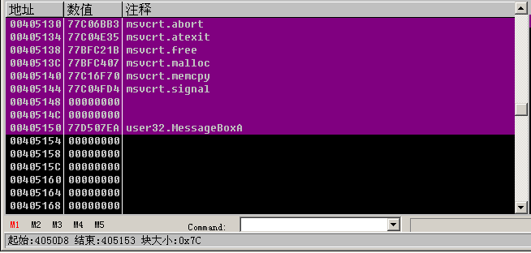

`ImportREC` を開き、デバッグ中のこのプログラムを選んで、`OEP: 1110, RVA:50D8, SIZE:7C` をそれぞれ入力し、`インポートテーブルを取得` をクリックします。

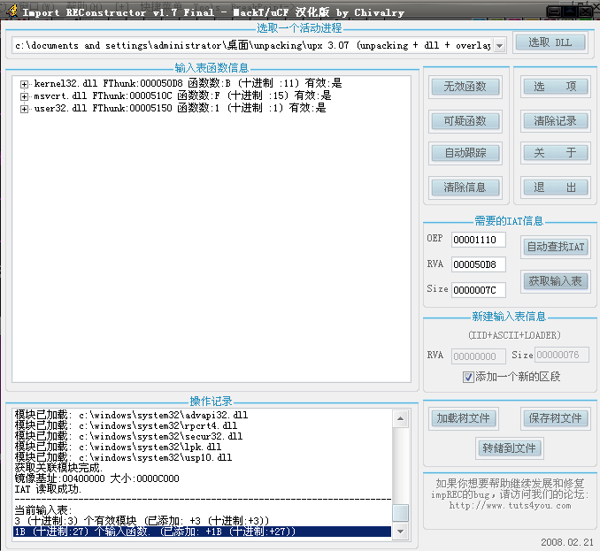

ここで、インポートテーブルのウィンドウで右クリックして `高度なコマンド->コードブロックを選択` を選びます。

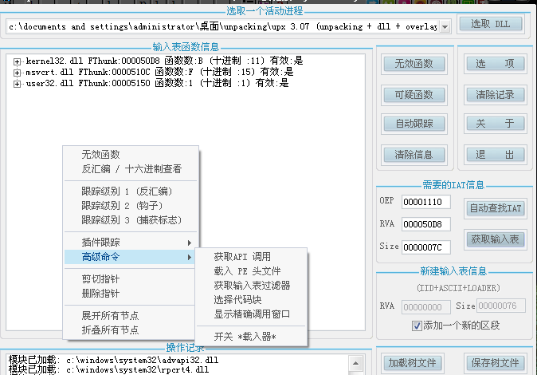

すると、ウィンドウが表示されるので、完全ダンプを選び、`dump.exe` ファイルとして保存します。

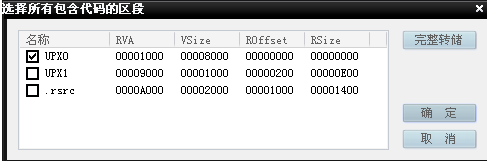

dump が終わったら、`ファイルにダンプ` を選びます。ここでは、先ほど dump した dump.exe を修復する対象に選び、`dump\_.exe` を得ます。これでアンパック全体が完了します。
