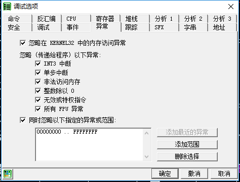
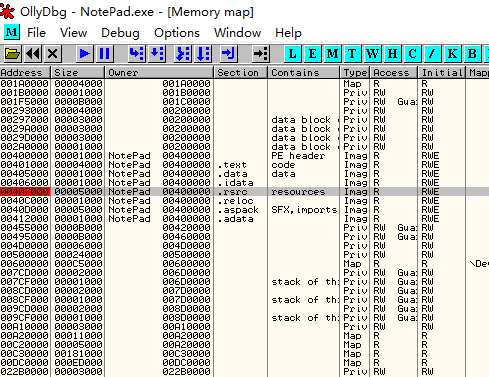
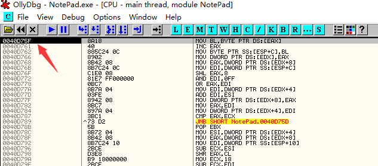
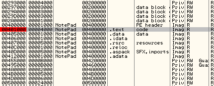
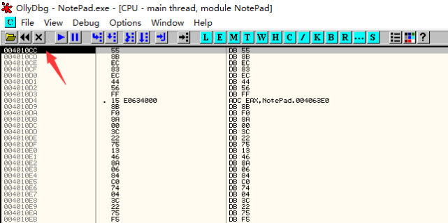

# メモリイメージ法

メモリイメージ法は、パックされたプログラムがロードされたときに、OllyDbg(OD)の `ALT+M` ショートカットでプログラムの仮想メモリ領域を開き、メモリに対するワンタイムブレークポイントを2回設定することで、プログラムの正しい OEP の位置に到達する方法です。

メモリイメージ法の原理は、プログラムのリソースセクションとコードセクションにブレークポイントを設定することにあります。一般にプログラムが自己解凍や自己復号を行うときは、まず必要なリソースを取得するためにリソースセクションにアクセスし、自動アンパックの完了後にプログラムのコードセクションへ戻ります。このタイミングでメモリのワンタイムブレークポイントを設定しておくと、プログラムは OEP で停止します。

## 要点

1. メニューの `オプション->デバッグ設定->例外` を選択する
2. すべての「例外を無視」にチェックを入れる
3. `ALT+M` を押してメモリマップを開き、プログラムの最初の `.rsrc` を探して F2 でブレークポイントを設定し、`SHIFT+F9` でブレークポイントまで実行する
4. もう一度 `ALT+M` を押してメモリマップを開き、最初の `.rsrc` の上にある `.text`(例では `00401000`)を探して F2 でブレークポイントを設定する。その後 `SHIFT+F9` を押す(例外が発生しない場合は F9 でもよい)

## 例

サンプルプログラムはこちらからダウンロードできます: [4_memory.zip](https://github.com/ctf-wiki/ctf-challenges/blob/master/reverse/unpack/4_memory.zip)

OD でプログラムをロードし、メニューバーの `オプション->デバッグ設定->例外タブ` ですべての「例外を無視」にチェックを入れます。

`Alt+M` を押してメモリマップを開き、リソースセクション、つまり `アドレス=00407000`、`サイズ=00005000` の `.rsrc` セクションを探し、選択して F2 でブレークポイントを設定します。

CPU ウィンドウに戻って F9 で実行すると、プログラムは `0040D75F` で停止しました。

もう一度 `Alt+M` を押してメモリマップを開き、`.text` コードセクションにブレークポイントを設定します。

さらに実行を続けると、プログラムは `004010CC`、つまり OEP で停止しました。

