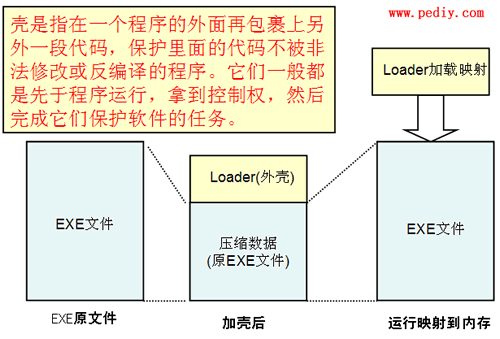

# プロテクタ(パッカー)の紹介

## 殻(パッカー)とは何かを知る

**殻(シェル、パッカー)** とは、コンピュータソフトウェアの中にある、ソフトウェアが不正に改変されたり逆コンパイルされたりしないよう保護する専用のプログラムのことです。

殻は一般に、本体のプログラムより先に実行されて制御を握り、ソフトウェアを保護するという役目を果たします。

このプログラムは、自然界の殻と機能面で共通する点が多いため、命名の規則に基づいて **殻** と呼ばれるようになりました。

## 殻の分類

**殻** は通常、圧縮型(圧縮シェル)と暗号化型(暗号化シェル)の2種類に分けられます。

### 圧縮シェル

圧縮シェルは DOS の時代からすでに存在していましたが、当時は計算能力が限られていて展開のオーバーヘッドが大きすぎたため、広くは使われませんでした。

圧縮シェルを使うと、PE ファイルのサイズを小さくでき、PE ファイル内部のコードとリソースを隠せるので、ネットワーク転送や保存に便利です。

圧縮シェルには通常2つの用途があります。1つは普通の PE ファイルを単純に圧縮するだけのもの、もう1つは元のファイルを大きく変形させ、PE ヘッダを激しく破壊するもので、後者はマルウェアの圧縮によく使われます。

よくある圧縮シェルには、UPX、ASPack、PECompact があります。

### 暗号化シェル

暗号化シェル(プロテクタ)は、コードのリバース解析を防ぐさまざまな技術を適用しており、最も主要な機能は PE をコードのリバース解析から守ることです。

暗号化シェルの主な目的はもはやファイルリソースの圧縮ではないため、暗号化シェルで保護された PE プログラムは、通常は元のファイルよりはるかに大きくなります。

現在、暗号化シェルは、セキュリティ要件が高く、クラックに敏感なアプリケーションで多用されています。同時に、マルウェアがウイルス対策ソフトの検出と駆除を回避(低減)するためにも使われています。

よくある暗号化シェルには、ASProtector、Armadillo、EXECryptor、Themida、VMProtect があります。

## 殻のロード過程

### エントリパラメータの保存

1.  パックされたプログラムの初期化時に、各レジスタの値を保存する
2.  殻の実行が完了したら、各レジスタの値を復元する
3.  最後に元のプログラムへジャンプして実行する

通常は `pushad` / `popad`、`pushfd` / `popfd` といった命令のペアで、実行環境の保存と復元を行います。

### 必要な関数 API の取得

1.  一般的な殻のインポートテーブルには、`GetProcAddress`、`GetModuleHandle`、`LoadLibrary` といった API 関数しかない
2.  ほかの API 関数が必要な場合は、`LoadLibraryA(W)` または `LoadLibraryExA(W)` で DLL ファイルを呼び出しプロセスのアドレス空間にマップする
3.  DLL ファイルがすでに呼び出しプロセスのアドレス空間にマップされている場合は、`GetModuleHandleA(W)` 関数を呼び出して DLL モジュールのハンドルを取得できる
4.  DLL モジュールがロードされたら、`GetProcAddress` 関数を呼び出して、インポートする関数のアドレスを取得できる

### 各ブロックのデータの復号

1.  元のプログラムのコードとデータを保護するため、一般に元のプログラムファイルの各ブロックは暗号化されている。プログラムの実行時に、殻がこれらのブロックのデータを復号し、プログラムが正常に動作できるようにする
2.  殻は一般にブロック単位で暗号化し、ブロック単位で復号して、復号したデータを適切なメモリ位置に戻す

### 元のプログラムのエントリポイントへのジャンプ

1.  エントリポイントへジャンプする前に、通常は元の PE ファイルのインポートテーブル(IAT)を復元して書き込み、再配置項目(主に DLL ファイル)を処理する
2.  パックの際に殻が自前のインポートテーブルを構築しているため、ここで各 DLL からインポートされるすべての関数のアドレスをあらためて取得し、IAT テーブルに書き込む必要がある
3.  上記の作業が終わると、制御を元のプログラムに渡し、実行を続ける
