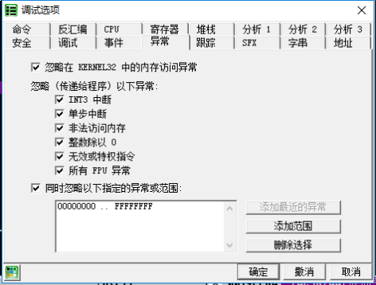
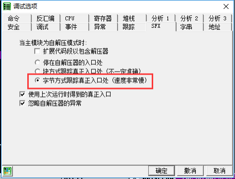
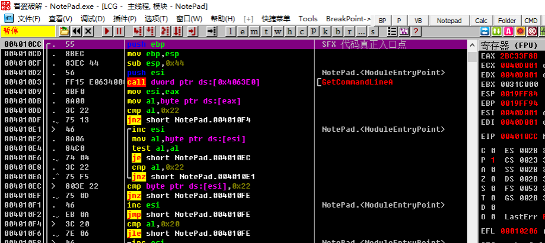

# SFX 法

「SFX」法は、OllyDbg に組み込まれている OEP 検出機能を利用します。OD が見つけた OEP でプログラムを直接停止させることができ、その時点でパッカーの展開処理は完了しているため、そのままプログラムをダンプできます。

## 要点

1. OD を設定して、すべての例外を無視する。つまり例外タブのチェックボックスをすべてオンにする
2. SFX タブに切り替え、「バイトモードで実際のエントリをトレース(非常に遅い)」を選択して OK を押す
3. プログラムを再ロードする(「コードを圧縮しますか?」と表示されたら「いいえ」を選ぶと、OD は OEP に直接到達する)

## 例

サンプルプログラムはこちらからダウンロードできます: [6_sfx.zip](https://github.com/ctf-wiki/ctf-challenges/blob/master/reverse/unpack/6_sfx.zip)

まず、メニューの `オプション->デバッグ設定->例外タブ` で、すべての「例外を無視」にチェックを入れます。

次に `SFX` タブに切り替え、「バイト方式で本当のエントリをトレース(非常に遅い)」を選択します。

プログラムを再ロードすると、プログラムはすでにコードのエントリポイントで停止しており、OEP を再解析する必要もありません。

