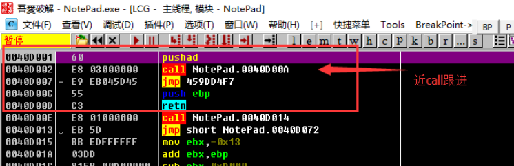
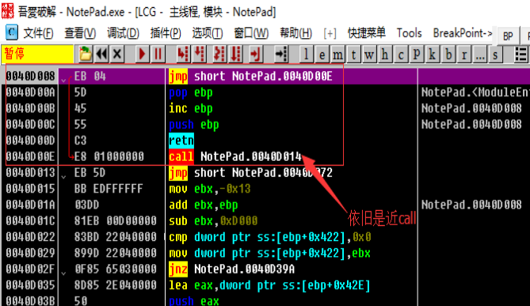
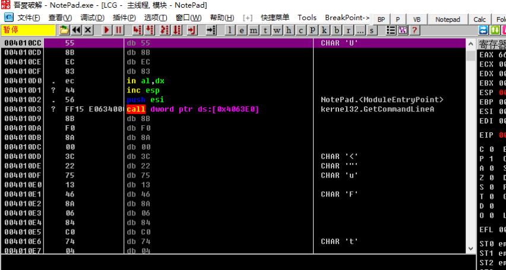
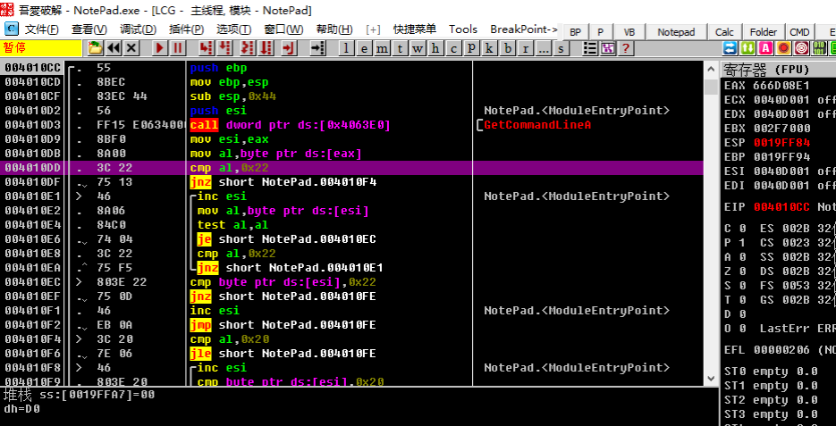

# ステップトレース法

ステップトレース法の原理は、OllyDbg のステップオーバー(F8)、ステップイン(F7)、カーソルまで実行(F4)の機能を使って、プログラムの自己アンパック処理を最後まで追うことです。コードを復元するループの部分はスキップし、ステップインで OEP を見落とさないようにします。こうして、ソフトウェアの自動アンパックモジュールの実行が終わった後に OEP に到達し、プログラムをダンプできます。

## 要点

1. プログラムを開いて F8 で下へステップ実行し、できるだけ下向きの jmp ジャンプを実現させる
2. 大きなループにたびたび遭遇するので、そのときは F4 を多用してループをスキップする
3. 関数のロード時に近くに call(近い call)がある場合は、そのまま飛ばさずに、できるだけその call の中に入る
4. 一般に、ジャンプ幅の大きい jmp 命令は、元のプログラムのエントリポイント(OEP)へのジャンプである可能性が非常に高い

## 例

サンプルプログラムはこちらからダウンロードできます: [1_trace.zip](https://github.com/ctf-wiki/ctf-challenges/blob/master/reverse/unpack/1_trace.zip)

ステップトレース法とは、要するにプログラムのエントリポイントからできるだけ1歩ずつ下へ進む方法です。ステップ実行の途中では EIP が逸れていかないよう注意します。ただし、やや複雑なパッカーでは、ステップ実行は非常に退屈で、自分でも混乱しやすくなります。そのため、ステップトレースは(静的解析と組み合わせて)重要なコード部分を分析するのに使われることが多く、最初から最後まですべてを分析することはあまりしません。それはリバースエンジニアリングの考え方に反するからです。

Ollydbg で圧縮ファイル内の Notepad.exe を開くと、下図の位置で停止しました。エントリポイントは `pushad` で全レジスタの状態をスタックに保存し、続いて `0040D00A` にある関数を `call` で呼び出しています。呼び出しの後は `459DD4F7` に無条件でジャンプし、その後の `push ebp` と `retn` は明らかに意味がありません。このようにエントリポイントのすぐ近くに `call` があるものを `近い call` と呼び、近い call ではステップインを選びます。F7 を押します(もっとも、ステップインしか選べません。そうしないと EIP が逸れてプログラムが停止してしまいます)。



ステップインするとまた `call` があるので、そのまま F7 でステップインを続けます。ステップインしていくと、もう近い call はなく、プログラムが `GetModuleHandleA` や `GetProcAddress` などの API を呼んでいるのが見えます。そのまま下へ分析を続けます。



その後、複数のジャンプに遭遇します。下向きのジャンプはできるだけ実行させ、上向きのジャンプは実行させずに F4 でループを抜けます。こうして `0040D3AF` まで進み、次のコードを見てみます。

``` asm
0040D3AF    61              	popad
0040D3B0    75 08           	jnz short NotePad.0040D3BA
0040D3B2    B8 01000000    	    mov eax,0x1
0040D3B7    C2 0C00         	retn 0xC
0040D3BA    68 CC104000     	push NotePad.004010CC
0040D3BF    C3              	retn
```

ここで `popad` により、プログラムのエントリポイントで保存したレジスタの状態が復元されます。次に `jnz` が `0040D3BA` にジャンプします。そこでは `push` と `retn` を使って `EIP` を `004010CC` に変更しています。つまり、パッカーがコードなどのリソースの展開を終えると、`jnz` で `push` の位置にジャンプし、`push` と `ret` で `EIP` をプログラムの元のエントリポイント(OEP)に設定して OEP に戻り、そこから元のプログラムのコードを実行し続けます。`retn` を実行して戻ると、次のように表示されます。



明らかに、`Ollydbg` がデータだと誤認している領域に来て実行を続けています。これは `Ollydbg` の解析の誤りなので、`Ollydbg` に再解析させる必要があります。右クリックして `解析->モジュールから解析を削除` を選ぶか、`ctrl+a` を押すと、OEP のアセンブリ命令が正しく表示されます。


