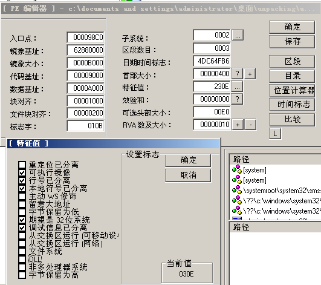
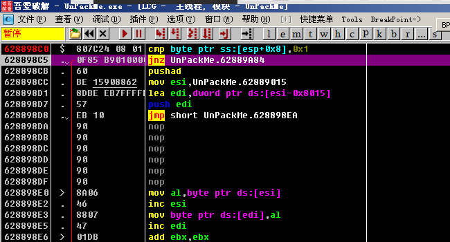

# DLL ファイルのアンパック

ここでは前の記事 [IAT を手動で探して ImportREC で再構築する](/reverse/unpack/manually-fix-iat/index.html) の内容が必要になります。

例題ファイルはこちらからダウンロードできます: [unpack_dll.zip](https://github.com/ctf-wiki/ctf-challenges/blob/master/reverse/unpack/unpack_dll.zip)

`Dll` のアンパックにはこの手順が必要です。`Dll` のアンパックで最も重要なのは、`LordPE で Dll のフラグを変更する` ことです。`LordPE` で `UnpackMe.dll` を開き、特性(Characteristics)の横の `...` をクリックして `DLL` フラグのチェックを外し、保存します。すると、システムはこのファイルを実行可能ファイルとして扱うようになります。

`UnpackMe.dll` の拡張子を `UnpackMe.exe` に変更し、OD でロードします。

通常、エントリポイントではプログラムが何らかの情報を保存しますが、ここでは非常に単純で、`cmp` を1つ行うだけです。注意点として、ここの `jnz` ジャンプは `unpacking` 処理の末尾に直接ジャンプしてしまいます。そのため、レジスタの `z` フラグを変更してジャンプを無効にする必要があります。同時に、アンパックが終わってそのまま実行されてしまうのを避けるため、`unpacking` 処理の末尾にブレークポイントを設定します(プログラムはこのブレークポイントで停止しますが、アンパックはすでに完了しており、コードははっきり読める状態になっています)。

`Dll` のアンパックの基本手順は `exe` ファイルのアンパックと同じです。`IAT` を再構築するときは、前の記事 [IAT を手動で探して ImportREC で再構築する](/reverse/unpack/manually-fix-iat/index.html) に書かれているとおり、`IAT` テーブルを手動で探して `ImportREC` で再構築する必要があります。ただし、アンパックしてダンプした後は、LordPE で `DLL` フラグを元に戻し、ファイルの拡張子を `.dll` に戻すのを忘れないでください。
