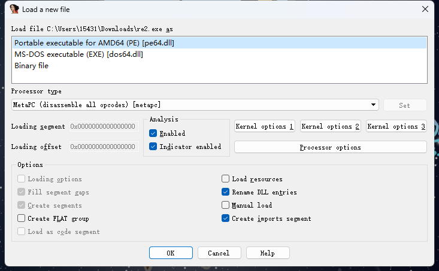
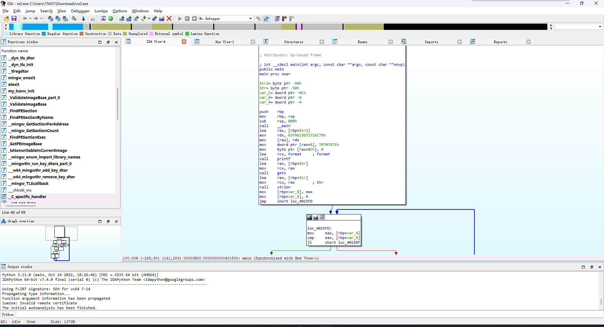
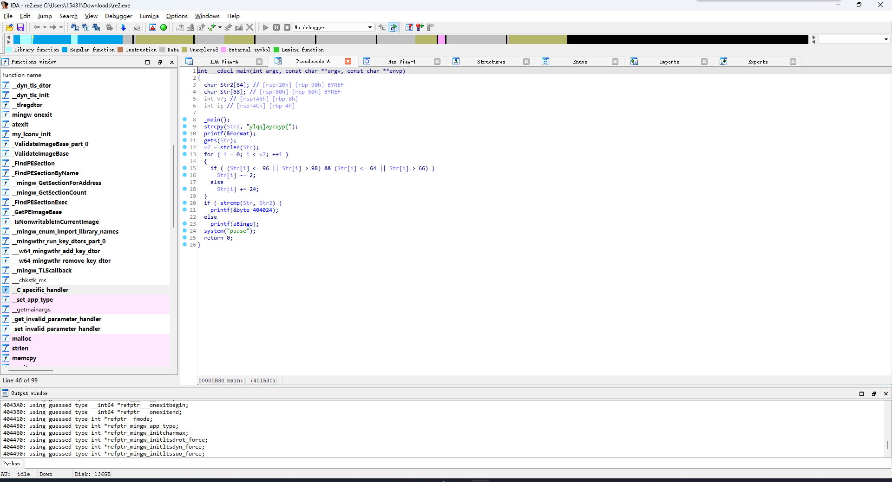
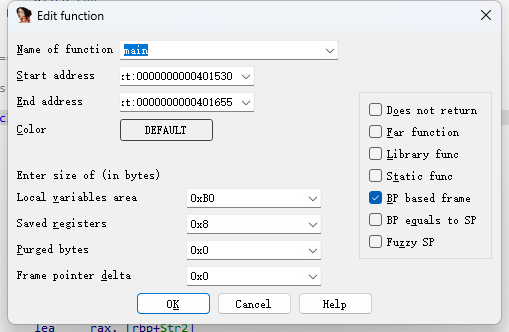
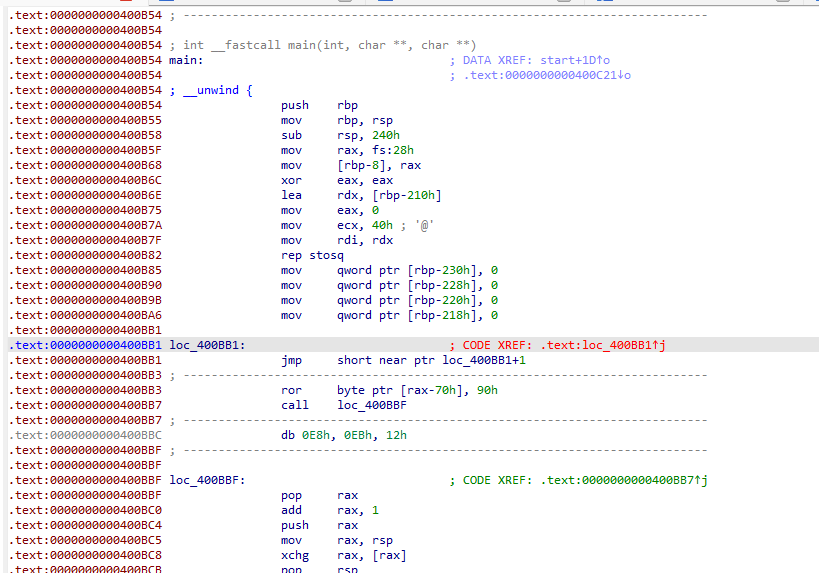
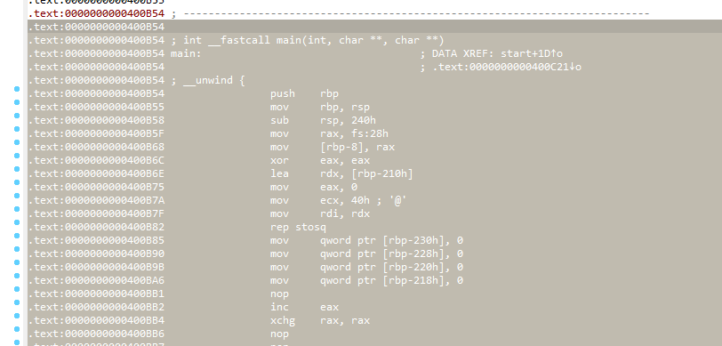
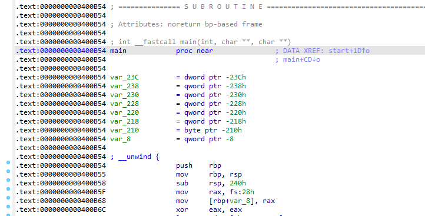
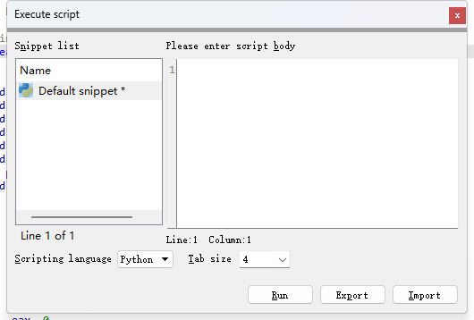
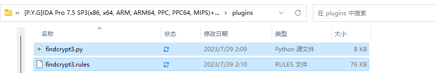
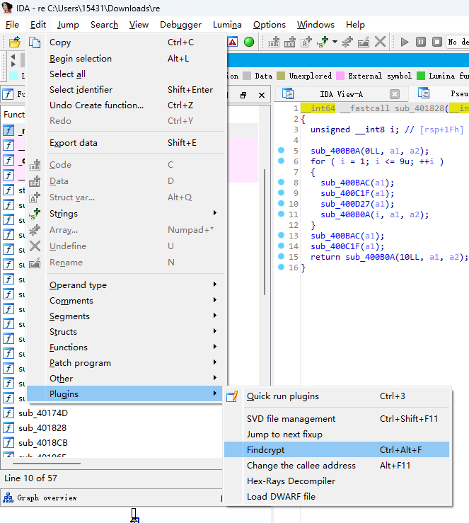

# IDA Pro

## はじめに

IDA Pro(Interactive Disassembler Professional)は Hex-Rays 社が提供する対話型の逆アセンブラで、ソフトウェアのリバースエンジニアリングで最も広く使われている静的解析ツールです。

IDA Pro は有料ソフトウェアで、本体とアーキテクチャごとのデコンパイルエンジンが別々に課金されることに注意してください。必要に応じて Hex-rays の公式サイトで該当するライセンスを購入して使用します。

> 2024年4月時点で、IDA Pro 本体のライセンス価格は 1975 USD、任意の命令セットアーキテクチャ1つ分のデコンパイル機能のライセンス価格は 2765 USD です。

このほか、Hex-rays 社はクラウドエンジンベースの無料リバースエンジニアリングツール [IDA Free](https://hex-rays.com/ida-free/) も提供していますが、現時点では x86 のみに対応しています。

## 基本的な使い方

IDA Pro には通常 `ida.exe` と `ida64.exe` の2つの実行ファイルが付属しており、それぞれ `32` ビットと `64` ビットのプログラムの解析に対応します。IDA Pro で実行可能なバイナリファイルを解析するときは、プログラムの命令セットのビット幅に応じて使う `ida` を選びます。

最も簡単な使い方は、解析したいバイナリ実行ファイルを IDA に直接ドラッグ&ドロップすることです。IDA はファイルの種類を自動的に識別するので、この段階では通常変更は不要で、そのまま 🆗 をクリックします。




すると、次のような画面が表示されます。



- `Function Windows`: IDA が識別した関数の一覧。ここから対応する関数に直接ジャンプできます
- `IDA-View`: IDA が逆アセンブルした単一の関数の結果をアセンブリ形式で表示します。デフォルトでは基本ブロックで構成される制御フローグラフの形式で表示されますが、`スペース` キーでメモリレイアウト上の生のアセンブリコードに切り替えることもできます
- `Hex View`: バイナリファイルの生データのビュー
- `Structures`: IDA が識別した、プログラム中に存在しうる構造体の情報
- `Enums`: IDA が識別した、プログラム中に存在しうる列挙型の情報
- `Imports`: このバイナリファイルの実行時に外部からインポートされる可能性のあるシンボル
- `Exports`: このバイナリファイルから外部へエクスポートできるシンボル

## 関数のデコンパイル

逆アセンブルに加えて、IDA はアセンブリコードを C/C++ 形式のソースコードにデコンパイルすることもできます。デコンパイルしたい関数の位置で `F5` を押すだけで、デコンパイル後のプログラムコードが得られます。



IDA が関数の範囲を誤って識別し、デコンパイル結果にずれが生じることがあります。その場合は、`IDA-View` ウィンドウで関数の先頭にカーソルを置いて `alt+p` を押し、関数の範囲を定義し直します。あるいは、まず `u` を押して既存の定義を解除し、関数の範囲を選択してから `p` を押して定義し直します。



コードの難読化などが原因で、IDA が関数を作成できないこともあります。



関数の識別を修復し終えたら、関数の先頭で `p` を押して IDA に関数を自動で再識別させるか、その関数に属するアセンブリコードを選択してから `p` を押して再識別させます。





## IDAPython

IDA Pro には Python と IDC のモジュールが組み込まれており、バイナリファイルの修正などの作業を素早く行えます。

`File` → `Script Command` から、IDAPython スクリプトを直接書いて実行できます。



使用する前に `ida` モジュールをインポートする必要があります。よく使う API には次のものがあります。

```python
idc.get_db_byte(addr)       # addr の 1 バイトを返す
idc.get_wide_word(addr)     # addr の 2 バイトを返す
idc.get_wide_dword(addr)    # addr の 4 バイトを返す
idc.get_qword(addr)         # addr の 8 バイトを返す
idc.get_bytes(addr, size, use_dbg) # addr の size バイトを返す
idc.patch_byte(addr, value)  # addr の 1 バイトを value に変更する(リトルエンディアン)
idc.patch_word(addr, value)  # addr の 2 バイトを value に変更する(リトルエンディアン)
idc.patch_dword(addr, value) # addr の 4 バイトを value に変更する(リトルエンディアン)
idc.patch_qword(addr, value) # addr の 8 バイトを value に変更する(リトルエンディアン)
```

その他の API と使い方は[公式ドキュメント](https://hex-rays.com/products/ida/support/idapython_docs/)を参照してください。

## IDA プラグイン

IDA はプラグインによる拡張に対応しており、プラグインを使うと IDA の機能を手軽に拡張・強化できます。

プラグインのインストールは通常かんたんです。`FindCrypt` プラグインを例にすると、このプラグインはプログラム中に存在する暗号アルゴリズムを自動で識別してくれます。インストールするには、まず [Github](https://github.com/polymorf/findcrypt-yara) からプラグインのソースコードを入手し、`IDAのインストールパス/plugins` フォルダに置きます。



システムに `yara` モジュールがインストールされていない場合は、インストールが必要です。

```bash
$ python -m pip install yara-python
```

これで `Edit→Plugin` からこのプラグインを使えるようになります。


