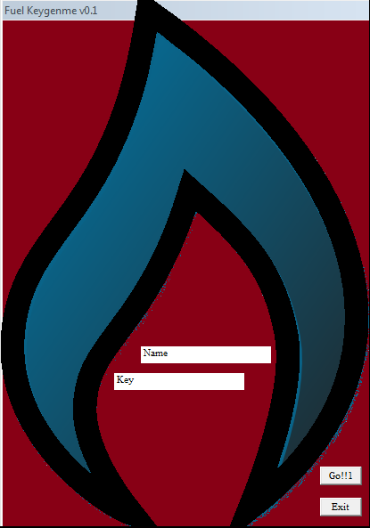

# 仮想マシン(VM)の解析

仮想マシンの解析については、簡単な crackme を使って説明します。

対応する `crackme` はこちらからダウンロードできます: [FuelVM.exe](https://github.com/ctf-wiki/ctf-challenges/blob/master/reverse/vm/fuelvm/FuelVM.exe)

対応する `keygenme` はこちらからダウンロードできます: [fuelvm_keygen.py](https://github.com/ctf-wiki/ctf-challenges/blob/master/reverse/vm/fuelvm/fuelvm_keygen.py)

対応する `IDA データベース` はこちらからダウンロードできます: [FuelVM.idb](https://github.com/ctf-wiki/ctf-challenges/blob/master/reverse/vm/fuelvm/FuelVM.idb)

この問題の作者は、多くの命令を持つ簡単な仮想マシンを設計しました。ここでは IDA を使って解析します。また、説明しやすいように、逆アセンブルで得られた変数の一部に名前を付け直しています。

## プログラムの実行

プログラム FuelVM.exe を実行します。画面は次のとおりです。



この画面には2つの入力欄があり、1つはユーザー名 Name を入力するため、もう1つはキー Key を入力するためのものです。ボタンも2つあり、Go は入力の送信用、Exit はプログラムの終了用です。

## ユーザー入力の取得

ここから手をつけられます。プログラムがユーザー入力を取得するために呼び出す API の1つが `GetDlgItemTextA()` です。

``` c
UINT GetDlgItemTextA(
  HWND  hDlg,
  int   nIDDlgItem,
  LPSTR lpString,
  int   cchMax
);
```

取得した入力文字列は `lpString` に保存されます。そこで IDA を開き、`GetDlgItemTextA()` へのクロスリファレンスがある場所を探します。

``` asm
.text:00401142                 push    0Ch             ; cchMax
.text:00401144                 push    offset inputName ; lpString
.text:00401149                 push    3F8h            ; nIDDlgItem
.text:0040114E                 push    [ebp+hWnd]      ; hDlg
.text:00401151                 call    GetDlgItemTextA
.text:00401156                 push    0Ch             ; cchMax
.text:00401158                 push    offset inputKey ; lpString
.text:0040115D                 push    3F9h            ; nIDDlgItem
.text:00401162                 push    [ebp+hWnd]      ; hDlg
.text:00401165                 call    GetDlgItemTextA
.text:0040116A                 mov     var_a, 0
.text:00401171                 call    process_input
.text:00401176                 jmp     short locExit
```

上のとおり、IDA で `GetDlgItemTextA` が呼ばれているのはここだけで、2回呼び出して、それぞれ `inputName` と `inputKey` を取得しています。その後、ある変数を0に初期化しています。この変数の役割はまだ分からないので、ひとまず `var_a` と名付けます。続いて関数を1つ呼び出し、jmp でジャンプしています。jmp の飛び先のコードはプログラムを終了させるコードなので、上の call はユーザー入力を処理する関数を呼び出していると断定できます。そこで jmp の飛び先を `locExit`、関数を `process_input` と名付け直します。

## ユーザー入力の処理

`process_input` 関数に入ると、この関数は入力文字列に対してごく簡単な処理しか行っていません。

```c
  result = strlength((int)inputName);
  if ( v1 >= 7 )                                // v1 = length of inputName
  {
    *(_DWORD *)&lenOfName = v1;
    result = strlength((int)inputKey);
    if ( v2 >= 7 )                              // v2 = length of inputKey
    {
      i = 0;
      do
      {
        inputName[i] ^= i;
        ++i;
      }
      while ( i <= *(_DWORD *)&lenOfName );
      unk_4031CE = i;
      dword_4031C8 = dword_4035FF;
      initVM();
      initVM();
      __debugbreak();
      JUMPOUT(*(_DWORD *)&word_4012CE);
    }
  }
  return result;
```

まず `strlength()` 関数です。この関数は `cld; repne scasb; not ecx; dec ecx` で文字列の長さを計算し、結果を `ecx` に保存します。アセンブリの基礎知識なので詳しくは説明しません。そこでこの関数を `strlength` と名付け直します。

```asm
.text:004011C2 arg_0           = dword ptr  8
.text:004011C2
.text:004011C2                 push    ebp
.text:004011C3                 mov     ebp, esp
.text:004011C5                 mov     edi, [ebp+arg_0]
.text:004011C8                 sub     ecx, ecx
.text:004011CA                 sub     al, al
.text:004011CC                 not     ecx
.text:004011CE                 cld
.text:004011CF                 repne scasb
.text:004011D1                 not     ecx
.text:004011D3                 dec     ecx
.text:004011D4                 leave
.text:004011D5                 retn    4
.text:004011D5 strlength       endp
```

IDA が生成した擬似 C コードには `v1` と `v2` があり、これには注釈を付けてあります。アセンブリを見ると、`ecx` と `7` を比較しており、`ecx` は文字列の長さです。したがって、入力に対する要求は *inputName と inputKey の長さがどちらも 7 以上であること* だと分かります。

`inputName` と `inputKey` の長さがどちらも 7 以上のときは、入力に簡単な変換を行います。次のループです。

```c
      i = 0;
      do
      {
        inputName[i] ^= i;
        ++i;
      }
      while ( i <= *(_DWORD *)&lenOfName );
```

対応する Python コードは次のとおりです。

``` python
def obfuscate(username):
    s = ""
    for i in range(len(username)):
        s += chr(ord(username[i]) ^ i)
    return s
```

関数はその後、いくつかの変数に値を代入しています(これらは重要ではないので、省略します)。

## SEH の登録

```asm
.text:004012B5                 push    offset seh_handler
.text:004012BA                 push    large dword ptr fs:0
.text:004012C1                 mov     large fs:0, esp
.text:004012C8                 call    initVM
.text:004012CD                 int     3               ; Trap to Debugger
```

`initVM` は仮想マシンの起動前の初期化処理(実際にはレジスタや関連部分に初期値を代入しているだけ)を行いますが、これは後で説明します。ここで注目するのは SEH の部分です。ここでは SEH ハンドラを1つ登録しており、例外処理関数を `seh_handler` と名付け直しました。その後、`int 3` で例外を手動で発生させています。`seh_handler` の位置では、IDA は対応するコードを正しく識別できていません。

``` 
.text:004012D7 seh_handler     db 64h                  ; DATA XREF: process_input+7Do
.text:004012D8                 dd 58Fh, 0C4830000h, 13066804h, 0FF640040h, 35h, 25896400h
.text:004012D8                 dd 0
.text:004012F4                 dd 1B8h, 0F7C93300h, 0F7C033F1h, 0FFC483E1h, 8F64FDEBh
.text:004012F4                 dd 5, 4C48300h, 40133068h, 35FF6400h, 0
.text:0040131C                 dd 258964h, 33000000h, 33198BC9h, 83E1F7C0h, 0FDEBFFC4h
.text:0040131C                 dd 58F64h, 83000000h, 5E6804C4h, 64004013h, 35FFh, 89640000h
.text:0040131C                 dd 25h, 0C033CC00h, 0C483E1F7h, 83FDEBFFh, 4035FF05h, 0D8B0200h
.text:0040131C                 dd 4035FFh, 3000B1FFh, 58F0040h, 4031C8h, 31C83D80h, 750A0040h
.text:0040131C                 dd 0B1FF4176h, 403000h, 31C8058Fh, 3D800040h, 4031C8h
```

該当位置をクリックして `c` キーを押すと、これらのデータをコードに変換して認識させられます(変換には `c` キーを何度か押す必要があります)。すると次のコードが得られます。

次のとおり、`seh_handler` の位置では、同様の方法で `401306h` にある例外処理関数をもう1つ登録し、`xor ecx,ecx; div ecx` で `ゼロ除算例外` を手動で発生させています。`loc_401301` の位置はアンチデバッグのテクニックで、`jmp loc_401301+2` は `EIP` を命令の途中に向けさせ、デバッグを続けられなくします。そこで `00401301~00401306` 部分のコードを `nop` にし、`00401306` の位置に新しい関数 `seh_handler2` を作成します。

```
seh_handler:                            ; DATA XREF: process_input+7Do
.text:004012D7                 pop     large dword ptr fs:0
.text:004012DE                 add     esp, 4
.text:004012E1                 push    401306h
.text:004012E6                 push    large dword ptr fs:0
.text:004012ED                 mov     large fs:0, esp
.text:004012F4                 mov     eax, 1
.text:004012F9                 xor     ecx, ecx
.text:004012FB                 div     ecx
.text:004012FD                 xor     eax, eax
.text:004012FF                 mul     ecx
.text:00401301
.text:00401301 loc_401301:                             ; CODE XREF: .text:00401304j
.text:00401301                 add     esp, 0FFFFFFFFh
.text:00401304                 jmp     short near ptr loc_401301+2
.text:00401306 ; ---------------------------------------------------------------------------
.text:00401306                 pop     large dword ptr fs:0
.text:0040130D                 add     esp, 4
.text:00401310                 push    401330h
.text:00401315                 push    large dword ptr fs:0
.text:0040131C                 mov     large fs:0, esp
.text:00401323                 xor     ecx, ecx
.text:00401325                 mov     ebx, [ecx]
.text:00401327                 xor     eax, eax
.text:00401329                 mul     ecx
```

同様に、`401330h` を `seh_handler3` と名付け直します。`40135Eh` は最後に登録される例外処理関数で、これが仮想マシンの本当の main 関数だと推測できるため、`40135Eh` を `vm_main` と名付け直します(SEH とアンチデバッグの部分は、自分で動的デバッグして理解することをおすすめします)。

## スタックバランスの回復

`vm_main` 関数を作成しました(名前を付け直した後、IDA に認識させるには関数として作成する必要があります)。ここで `F5` を押すと失敗します。失敗の原因はスタックが不均衡なことです。そこで、IDA のメニュー項目 `Options->General` を開き、右側の `stack pointer` にチェックを入れます。すると対応するスタックポインタが表示されます。

```
.text:004017F2 000                 jmp     vm_main
.text:004017F7     ; ---------------------------------------------------------------------------
.text:004017F7 000                 push    0               ; uType
.text:004017F9 004                 push    offset aError   ; "Error"
.text:004017FE 008                 push    offset Text     ; "The key is wrong."
.text:00401803 00C                 push    0               ; hWnd
.text:00401805 010                 call    MessageBoxA
.text:0040180A
.text:0040180A     locret_40180A:                          ; CODE XREF: vm_main+492j
.text:0040180A 000                 leave
.text:0040180B -04                 leave
.text:0040180C -08                 leave
.text:0040180D -0C                 leave
.text:0040180E -10                 leave
.text:0040180F -14                 leave
.text:00401810 -18                 leave
.text:00401811 -1C                 retn
.text:00401811     vm_main         endp ; sp-analysis failed
```

一番下の、不均衡が表示されている位置に来ます。一番上の `jmp vm_main` は、仮想マシンの内部でループが実行されていることを示します。`MessageBoxA` の呼び出しは、最後にポップアップするエラーメッセージを表示するものです。`locret_40180A` の位置では、leave が何度も実行されてスタックが大きく不均衡になっているため、手動でスタックバランスを回復する必要があります。

これも簡単で、`0040180A` の位置ではすでにスタックが均衡している(000)ので、この `leave` を `retn` に書き換えるだけです。次のようにします。

```
.text:0040180A     locret_40180A:                          ; CODE XREF: vm_main+492j
.text:0040180A 000                 retn
.text:0040180B     ; ---------------------------------------------------------------------------
.text:0040180B 004                 leave
.text:0040180C 004                 leave
.text:0040180D 004                 leave
```

すると、`vm_main` で F5 を押して擬似 C コードを生成できるようになります。

## 仮想マシンの命令の解析

正直なところ、仮想マシンの解析は比較的退屈な復元作業です。各部分の操作を突き合わせて、それがどんな命令なのか、どのレジスタを使っているのかを判断する必要があります。この crackme では、VM は `フェッチ-デコード-実行` のループを行っています。`デコード` の処理から得られる情報が最も多く、さまざまな命令がここで、それぞれの `opcode` に応じて `if-else if-else` の分岐で区別されます。実際の復元作業は複雑ではありませんが、仮想マシンが実装している命令の数によっては、やや退屈に感じるかもしれません。

最終的に解析した結果は次のとおりです。

| opcode | value |
| ------ | ----- |
| push   | 0x0a  |
| pop    | 0x0b  |
| mov    | 0x0c  |
| cmp    | 0x0d  |
| inc    | 0x0e  |
| dec    | 0x0f  |
| and    | 0x1b  |
| or     | 0x1c  |
| xor    | 0x1d  |
| check  | 0xff  |

次に、解析後の `initVM` 関数を見ます。

```c
int initVM()
{
  int result; // eax@1

  r1 = 0;
  r2 = 0;
  r3 = 0;
  result = (unsigned __int8)inputName[(unsigned __int8)cur_index];
  r4 = (unsigned __int8)inputName[(unsigned __int8)cur_index];
  vm_sp = 0x32;
  vm_pc = 0;
  vm_flags_zf = 0;
  vm_flags_sf = 0;
  ++cur_index;
  return result;
}
```

ここには4つの汎用レジスタ(`r1/r2/r3/r4`)、1つの `sp` ポインタ、1つの `pc` ポインタ、フラグ `zf` と `sf` があります。先ほど役割が分からなかった `var_a` も `cur_index` と名付け直しました。これは `inputName` で現在処理している文字のインデックスを指します。

VM が実装している各命令についてはこれ以上述べず、`check` 部分の操作を重点的に見ます。

```c
int __fastcall check(int a1)
{
  char v1; // al@1
  int result; // eax@4

  v1 = r1;
  if ( (unsigned __int8)r1 < 0x21u )
    v1 = r1 + 0x21;
  LOBYTE(a1) = cur_index;
  if ( v1 == inputKey[a1] )
  {
    if ( (unsigned __int8)cur_index >= (unsigned __int8)lenOfName )
      result = MessageBoxA(0, aGoodJobNowWrit, Caption, 0);
    else
      result = initVM();
  }
  else
  {
    result = MessageBoxA(0, Text, Caption, 0);
  }
  return result;
}
```

`r1` の値が `inputKey[cur_index]` と等しければ、`inputName` 全体の検査が終わったかどうかをさらに判定します。エラーがなく比較が終わっていれば、`Good job! Now write a keygen.` というメッセージボックスが表示されます。そうでなければ `initVM` を続けて次のループに入ります(エラーのときは、もちろんエラーを知らせるメッセージボックスが表示されます)。

`cur_index` は `initVM` の中で1ずつ増えます。さて、先ほど `process_input` の中で `initVM` が2回実行されていたのを覚えているでしょうか。`initVM` が2回実行されるため、`inputKey` の最初の2文字は任意の文字でかまいません。

```c
      unk_4031CE = i;
      opcode = vm_pc;
      initVM();
      initVM();
      __debugbreak();
      JUMPOUT(*(_DWORD *)&word_4012CE);
```

以上で仮想マシン全体の解析が終わったので、`Keygen` の作成に取りかかれます。

対応する `keygenme` はこちらからダウンロードできます: [fuelvm_keygen.py](https://github.com/ctf-wiki/ctf-challenges/blob/master/reverse/vm/fuelvm/fuelvm_keygen.py)

```bash
$ python2 fuelvm_keygen.py ctf-wiki
[*] Password for user 'ctf-wiki' is: 4mRC*TKJI
```

対応する `IDA データベース` はこちらからダウンロードできます: [FuelVM.idb](https://github.com/ctf-wiki/ctf-challenges/blob/master/reverse/vm/fuelvm/FuelVM.idb)